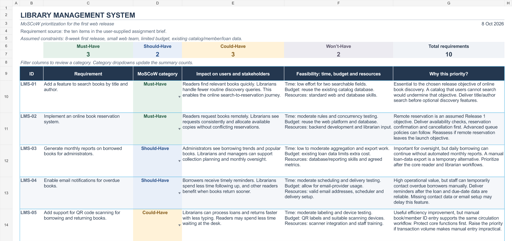
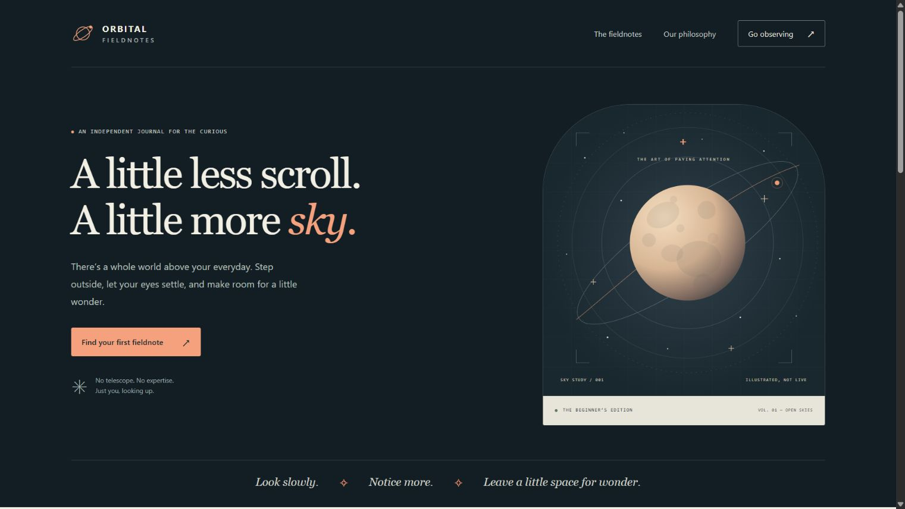
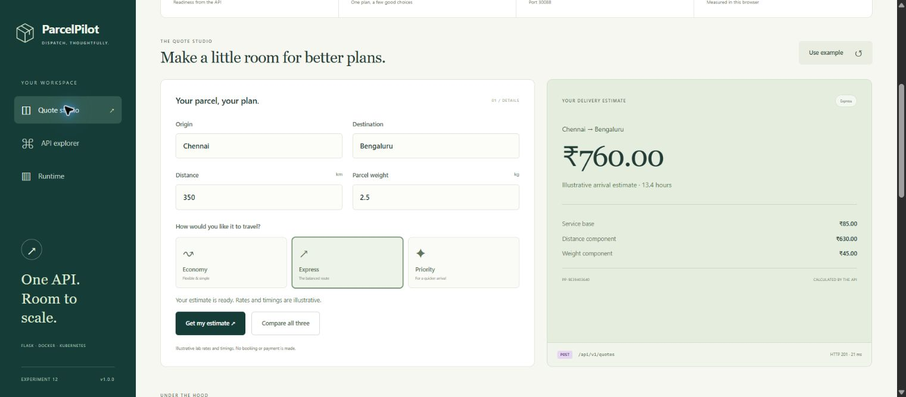
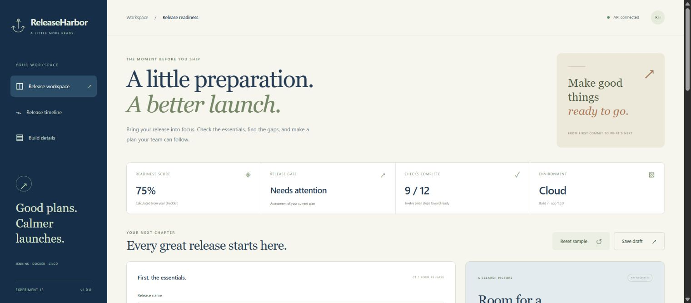
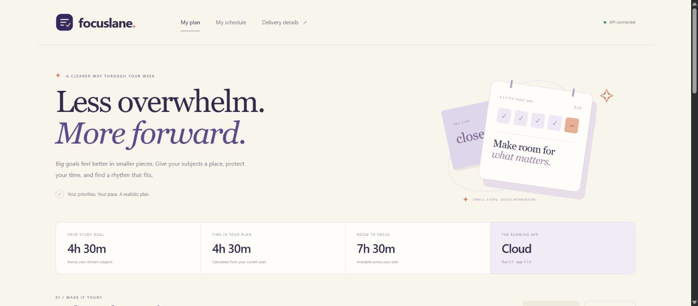
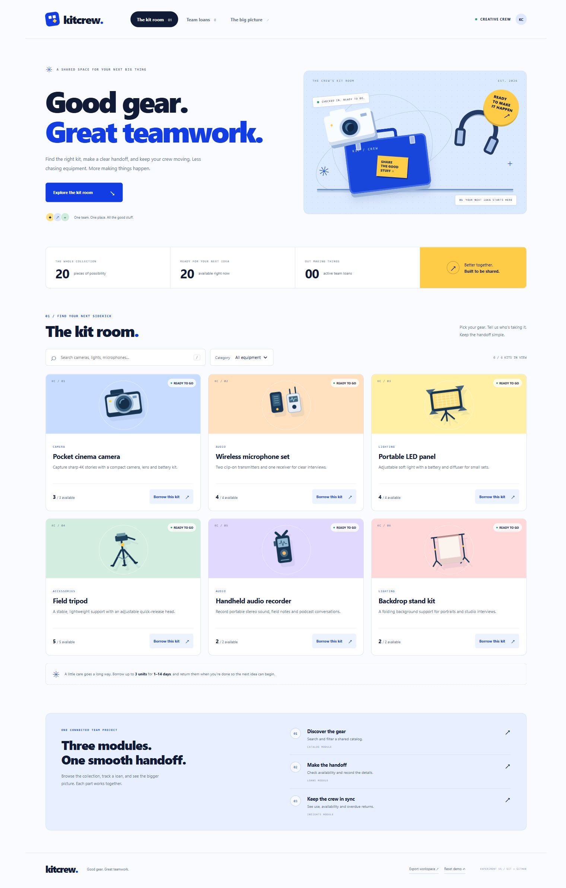

# CSA1020-Software_Engineering

A shared software engineering laboratory repository for **Md-Aslam-31**

This contribution includes Experiments 01-15, 128 screenshots, the Excel workbook, and the available application source. Experiments 11-15 were added on 27 October 2026 with their reports, screenshots, source, and quick-access links. The experiments were prepared using Emadfar007. Historical screenshots and pull-request links retain their original project context in the [source repository](https://github.com/Emadfar007/CSA1020---Software-Engineering).

| Experiment | Description | Files |
| --- | --- | --- |
| 01 | Trello Kanban board with five sample tasks and workflow simulation | [Kanban Board](experiments/experiment-01-kanban-board/README.md) |
| 02 | Desktop Figma prototype and local bus booking website with accounts, editable tickets, and personal reviews | [Bus Ticket Booking](experiments/experiment-02-bus-ticket-booking/README.md) |
| 03 | E-commerce mobile prototype in Figma, with a local shopping app and stakeholder review workflow | [E-commerce Stakeholder Prototype](experiments/experiment-03-ecommerce-mobile-app/README.md) |
| 04 | Jira Scrum project with eight prioritized stories, a one-week sprint, workflow simulation, and dated Timeline categories | [Jira Scrum](experiments/experiment-04-jira-scrum/README.md) |
| 05 | Library Management System requirements categorized and justified using MoSCoW in an Excel workbook | [Library MoSCoW Prioritization](experiments/experiment-05-library-moscow/README.md) |
| 06 | Jira and Confluence integration for Library Management System task tracking and sprint progress monitoring | [Jira and Confluence Integration](experiments/experiment-06-jira-confluence/README.md) |
| 07 | Task Management System requirements prioritized using MoSCoW and Kano in Jira, with a sample sprint and progress reporting | [Task Management Prioritization](experiments/experiment-07-task-management-prioritization/README.md) |
| 08 | Online Learning Platform requirements prioritized using MoSCoW and Kano in Jira, with a sample sprint, timeline, and progress reporting | [Online Learning Prioritization](experiments/experiment-08-online-learning-prioritization/README.md) |
| 09 | Git/GitHub fork, clone, feature branch, pull request, disclosed self-review, follow-up fixes, and merge | [GitHub Collaboration](experiments/experiment-09-github-collaboration/README.md) |
| 10 | Real Git branch divergence, two-file merge conflict, manual combined resolution, and a FairSeat feature pull request | [Branching and Merge Conflicts](experiments/experiment-10-merge-conflicts/README.md) |
| 11 | Original static website packaged in a Docker image and served locally by Nginx, with a healthy container and verified browser workflow | [Docker Static Website](experiments/experiment-11-docker-static-website/README.md) |
| 12 | Flask delivery-estimate API built and pushed with Docker, then deployed to Kubernetes through NodePort, with scaling and pod-recovery verification | [Flask, Docker and Kubernetes](experiments/experiment-12-flask-docker-kubernetes/README.md) |
| 13 | Local Jenkins CI/CD pipeline with Docker builds, automated tests, commit polling, image publication and verified deployment to Render Free | [Jenkins CI/CD with Docker](experiments/experiment-13-jenkins-cicd/README.md) |
| 14 | GitHub Actions continuous deployment with tested Docker images, immutable Docker Hub publication, PR validation and automatic Render Free deployment | [GitHub Actions Continuous Deployment](experiments/experiment-14-github-actions-cd/README.md) |
| 15 | Team project with module branches, reviewed pull requests, follow-up commits, genuine conflict resolution and a verified KitCrew application | [Team Version Control](experiments/experiment-15-team-version-control/README.md) |
| 16 | Persistent Flask to-do app containerized with Docker, verified task workflows and restart recovery, and published Docker Hub image | [Morrow Flask To Do App](experiments/experiment-16-flask-todo-docker/README.md) · [Browser lab - start 16](https://github.com/Emadfar007/CSA1020---Software-Engineering/blob/main/browser-lab/README.md) · [Screenshots](experiments/experiment-16-flask-todo-docker/screenshots/) |
| 17 | Original static website built, tagged and pushed to Docker Hub, then pulled and verified on an isolated receiving Docker engine | [Docker Hub Push and Pull](experiments/experiment-17-dockerhub-push-pull/README.md) · [Browser lab - start 17](https://github.com/Emadfar007/CSA1020---Software-Engineering/blob/main/browser-lab/README.md) · [Screenshots](experiments/experiment-17-dockerhub-push-pull/screenshots/) |
| 18 | Three-tier seed library on Kubernetes with Nginx, Flask, persistent PostgreSQL, real Headlamp monitoring and frontend scaling | [Multi-Container Kubernetes Application](experiments/experiment-18-sprouthouse-kubernetes/README.md) · [Browser lab - start 18](https://github.com/Emadfar007/CSA1020---Software-Engineering/blob/main/browser-lab/README.md) · [Screenshots](experiments/experiment-18-sprouthouse-kubernetes/screenshots/) |
| 19 | Flask application tested and published by GitHub Actions, then automatically deployed and verified in the private browser lab | [Flask CI/CD with GitHub Actions](experiments/experiment-19-github-actions-flask/README.md) · [Open Packlight](https://miserable-cobweb-4j9pjv79r7w7fjrqw-8099.app.github.dev/) · [Open Actions workflow](https://github.com/Emadfar007/CSA1020---Software-Engineering/actions/workflows/experiment-19-cicd.yml) · [Screenshots](experiments/experiment-19-github-actions-flask/screenshots/) |
| 20 | Private personal repository initialized with a README, cloned locally, updated, staged, committed and pushed with verified Git history | [GitHub Repository Setup](experiments/experiment-20-github-repository-setup/README.md) · [Open private personal repository](https://github.com/Emadfar007/little-milestones-journal) · [Screenshots](experiments/experiment-20-github-repository-setup/screenshots/) |
| 21 | Existing public repository cloned locally and a one-line README clarification saved, with the original edit left uncommitted | [Clone and Edit a Repository](experiments/experiment-21-clone-and-edit/README.md) · [Open source repository](https://github.com/Emadfar007/learnloop-collaboration-demo) · [Screenshots](experiments/experiment-21-clone-and-edit/screenshots/) |
| 22 | Saved README change staged, committed with the exact message Updated README, and pushed with matching local and remote commits | [Commit and Push Changes](experiments/experiment-22-commit-and-push/README.md) · [Open pushed commit](https://github.com/Emadfar007/learnloop-collaboration-demo/commit/e711339b1c18a6258cbf7de1973ab0e9bbe23217) · [Screenshots](experiments/experiment-22-commit-and-push/screenshots/) |
| 23 | Approved same-account collaborator simulation in a second clone, followed by git pull origin main and verification of the update | [Pull Collaborator Updates](experiments/experiment-23-pull-collaborator-updates/README.md) · [Open pulled update](https://github.com/Emadfar007/learnloop-collaboration-demo/commit/8d9569910648791e4a0531233889c0ab402e1217) · [Screenshots](experiments/experiment-23-pull-collaborator-updates/screenshots/) |
| 24 | feature-login branch, standalone Python login function, pushed feature commit and a merged pull request into main | [Feature Branch and Login Pull Request](experiments/experiment-24-feature-login-pull-request/README.md) · [Open merged login PR](https://github.com/Emadfar007/learnloop-collaboration-demo/pull/3) · [Screenshots](experiments/experiment-24-feature-login-pull-request/screenshots/) |
| 25 | Existing fork cloned and fetched, additive JSON progress export feature pushed on a new branch, and an open pull request into the user's fork | [Fork, Feature Branch and Pull Request](experiments/experiment-25-fork-feature-pull-request/README.md) · [Open feature PR](https://github.com/Emadfar007/learnloop-collaboration-demo/pull/4) · [Screenshots](experiments/experiment-25-fork-feature-pull-request/screenshots/) |

Each experiment includes only Aim, Tools Required, Algorithm, Output Screenshots, and Result.

## Additional submission - Experiments 16 to 25

Experiments **16-25** were added on **29 October 2026**, including their reports, source, recorded testing evidence and **47 screenshots**. This collection now contains **25 experiments and 175 screenshots**. Use the report and screenshot links in the table above.

These experiments were completed using **Emadfar007**. Original screenshots, commits, pull requests, Docker Hub images and Actions runs keep their original attribution and links. The copied workflow files are submission references; automated deployments continue in the [original repository](https://github.com/Emadfar007/CSA1020---Software-Engineering).

For the existing Docker/Kubernetes browser runtime, open the [original browser lab guide](https://github.com/Emadfar007/CSA1020---Software-Engineering/blob/main/browser-lab/README.md). Resume its Codespace and run the requested profile there. Private application and personal-repository links require access to Emadfar007's resources; copying the reports does not grant that access. Four copied README files adjust reference links to their original source destinations; all other submitted experiment files retain the original bytes.


## Quick access - Experiments 11 to 15

| Experiment | Open the application | Open tools and progress | Full report and screenshots |
| --- | --- | --- | --- |
| 11 - Orbital Fieldnotes | [Local website](http://127.0.0.1:8087/) | [Health check](http://127.0.0.1:8087/healthz) | [Experiment 11](https://github.com/Md-Aslam-31/CSA1020-Software_Engineering/tree/main/experiments/experiment-11-docker-static-website#quick-access-links) |
| 12 - ParcelPilot | [Kubernetes app](http://127.0.0.1:30088/) · [Docker app](http://127.0.0.1:8088/) | [API specification](http://127.0.0.1:30088/openapi.json) · [Docker Hub](https://hub.docker.com/r/coastrider7/csa1020-exp12-parcelpilot-api/tags) | [Experiment 12](https://github.com/Md-Aslam-31/CSA1020-Software_Engineering/tree/main/experiments/experiment-12-flask-docker-kubernetes#quick-access-links) |
| 13 - ReleaseHarbor | [Cloud application](https://releaseharbor-exp13.onrender.com/) | [Jenkins job](http://127.0.0.1:8090/job/ReleaseHarbor-CICD/) · [Latest successful build](http://127.0.0.1:8090/job/ReleaseHarbor-CICD/lastSuccessfulBuild/) · [Render](https://dashboard.render.com/web/srv-dbflq8vb9u1s73de444g) | [Experiment 13](https://github.com/Md-Aslam-31/CSA1020-Software_Engineering/tree/main/experiments/experiment-13-jenkins-cicd#quick-access-links) |
| 14 - FocusLane | [Cloud application](https://focuslane-exp14.onrender.com/) | [GitHub Actions](https://github.com/Emadfar007/CSA1020---Software-Engineering/actions/workflows/experiment-14-cd.yml) · [Docker Hub](https://hub.docker.com/r/coastrider7/csa1020-exp14-focuslane/tags) · [Render](https://dashboard.render.com/web/srv-dbfnbggm7kps739nrok0) | [Experiment 14](https://github.com/Md-Aslam-31/CSA1020-Software_Engineering/tree/main/experiments/experiment-14-github-actions-cd#quick-access-links) |
| 15 - KitCrew | [Local application](http://127.0.0.1:4845/) | [Private team repository](https://github.com/Emadfar007/kitcrew-team-project) · [Module reviews](https://github.com/Emadfar007/kitcrew-team-project/pulls?q=is%3Apr) · [Passing checks](https://github.com/Emadfar007/kitcrew-team-project/actions/runs/40360742707) | [Experiment 15](https://github.com/Md-Aslam-31/CSA1020-Software_Engineering/tree/main/experiments/experiment-15-team-version-control#quick-access-links) |

Each report's **Tools Required → Quick access links** table contains its app, source, screenshots, checks, and relevant platform links. Addresses beginning with `127.0.0.1` open on the computer running the corresponding demo; they are not public hosting links. Start Docker Desktop for Experiments 11-13. For KitCrew, run `npm start --prefix experiments/experiment-15-team-version-control/app` from this repository's root. Jenkins and private GitHub/Render management pages may require your existing login. Render Free apps may take time to wake after inactivity.


## Experiment previews

### Kanban board


### Bus booking desktop prototype


### E-commerce mobile prototype


### Jira Scrum project


The sample Jira project includes a dated Timeline and detailed ownership, acceptance criteria, and dependencies. Its current simulated progress snapshot shows four stories To Do, three In Progress, and one Done. Original sprint-start and sprint-end screenshots are included in Experiment 04.

### Library Management System priorities



Experiment 05 includes a downloadable Excel workbook with all ten requirements, impact, feasibility, and priority justification. The workbook can also be imported into Google Sheets.

### Library Management System task tracking


Experiment 06 links seven Jira stories to a Confluence project overview. Its simulated checkpoint shows two Done, three In Progress, and two To Do tasks, with a manually updated completion snapshot of **28.6%**.

### Task Management System prioritization


Experiment 07 includes twelve requirements across four feature epics, independent MoSCoW and Kano fields, detailed rationale, eight tested filters, 26 prerequisite links, and nine screenshots. Its one-week sample sprint demonstrates To Do, In Progress, In Review, and Done work. Kano classifications remain unvalidated hypotheses, and workflow statuses represent simulated progress.

### Online Learning Platform prioritization


Experiment 08 includes all six requested features within nine detailed requirements, three epics, 16 prerequisite links, seven tested model filters, and ten screenshots. The one-week sample sprint demonstrates progress across four workflow stages. Kano classifications are unvalidated hypotheses, and workflow progress is simulated.

### Git and GitHub collaboration


Experiment 09 includes ten screenshots documenting a fork of octocat/Spoon-Knife, a working LearnLoop dashboard, two feature commits, review feedback, passing checks, and [merged pull request #1](https://github.com/Emadfar007/learnloop-collaboration-demo/pull/1). Its navigation follow-up adds distinct Learning path, My progress, and Workflow guide views, verified across 16 browser checkpoints and merged in [pull request #2](https://github.com/Emadfar007/learnloop-collaboration-demo/pull/2). All 13 tests passed. Only Emadfar007 was used, so the review is explicitly a self-review informed by assistant code inspection, without independent human approval. The merges target the user's fork's main branch.

### Git branching and merge conflicts


Experiment 10 demonstrates genuine conflicts in the seat allocator and release policy, generated through two local clones using Emadfar007. The manual resolution preserves VIP-first ordering, overflow waiting lists, capacity validation, and valid attendee records. The experiment includes captured Git output, nine screenshots, a local evidence journal, 20 passing tests, and ten planner browser checks. [Pull request #1](https://github.com/Emadfar007/CSA1020---Software-Engineering/pull/1) is merged into main, preserving the actual two-parent conflict-resolution commit and publishing the completed report and app.

### Static website with Docker and Nginx



Experiment 11 includes the Orbital Fieldnotes website, Dockerfile, Nginx configuration, a restricted build context, six screenshots, and recorded build/runtime evidence. The image was built successfully, the container became healthy, and all eleven browser checks passed. The website runs locally at port 8087, with no host directory mounts or public deployment.

### Flask API with Docker and Kubernetes



Experiment 12 includes the ParcelPilot Flask API, interactive quote studio and JSON explorer, Dockerfile, Kubernetes manifests, deployment scripts, nine screenshots, and recorded verification evidence. The image was pushed to [Docker Hub](https://hub.docker.com/r/coastrider7/csa1020-exp12-parcelpilot-api/tags) and deployed by a local kind cluster with two Ready replicas through NodePort 30088. All 17 API tests passed; replica routing, scaling to three replicas and automatic replacement of a removed test pod were verified. The final replica count is two. Rates are illustrative and quotes are stateless.

### Jenkins CI/CD with Docker



Experiment 13 includes the ReleaseHarbor app, a multi-stage Dockerfile, Jenkinsfile, local Jenkins setup, deployment helpers, nine screenshots and actual build evidence. A Git commit triggered Jenkins build #7, which passed 21 tests, verified the runtime container, published a build-specific Docker Hub image and deployed its exact digest to [Render](https://releaseharbor-exp13.onrender.com/). The running app's source SHA and build number matched Jenkins. An intentional failed gate also blocked publication and deployment. Jenkins runs locally; the cloud app uses Render Free with idle sleep and monthly limits, without a fixed trial-expiry date.

### GitHub Actions continuous deployment



Experiment 14 includes FocusLane, an editable study-sprint planner, a multi-stage Dockerfile, a hosted GitHub Actions workflow, ten screenshots and actual delivery receipts. Merging [pull request #2](https://github.com/Emadfar007/CSA1020---Software-Engineering/pull/2) automatically triggered [run #3](https://github.com/Emadfar007/CSA1020---Software-Engineering/actions/runs/40353497794), which passed 23 application tests and four CI guard checks, pushed the tested image to Docker Hub, and deployed its exact digest to [Render](https://focuslane-exp14.onrender.com). The cloud app's version 1.1.0, source commit and run 3.1 matched the pipeline. Pull requests validate without publishing or deploying. The hosted pipeline works while the local computer is off; Render Free has idle sleep and shared monthly limits.

### Team project version control



Experiment 15 archives KitCrew's team version-control workflow, application source, ten screenshots and recorded evidence. Three module branches were merged after documented COMMENT reviews, including a follow-up regression test and a genuine manually resolved policy conflict. All 26 module tests and 17 browser checks passed. The original workflow repository remains private; the report and captured evidence are available in this public experiment archive.


## Local testing

For Experiment 15, run `npm start --prefix experiments/experiment-15-team-version-control/app` from the repository root and open `http://127.0.0.1:4845/`. Its [report](experiments/experiment-15-team-version-control/README.md) includes test commands and the branch/review/conflict workflow.

For Experiment 14, open [FocusLane in the cloud](https://focuslane-exp14.onrender.com) or follow its [Docker commands and report](experiments/experiment-14-github-actions-cd/README.md) for local testing. Application changes pushed to `main` trigger the hosted pipeline. A sleeping Free cloud instance may take time to start.

For Experiment 13, follow the [Jenkins CI/CD report](experiments/experiment-13-jenkins-cicd/README.md). On a fresh machine, run `./scripts/start-lab.ps1` from that experiment directory. When restarting an existing lab, supply its original private secret directory as documented. Open the local Jenkins job at `http://127.0.0.1:8090/job/ReleaseHarbor-CICD/`; commit polling operates while this computer, Docker and Jenkins are running.

For Experiment 12, follow its [report and commands](experiments/experiment-12-flask-docker-kubernetes/README.md). With Docker running, create the supplied kind cluster once, then run `./scripts/deploy.ps1` from the experiment directory. Access the application at `http://127.0.0.1:30088/` on the computer running the cluster. The API runs locally for testing; its container image is published to Docker Hub.

For Experiment 11, open a terminal in `experiments/experiment-11-docker-static-website/` with Docker running, then run:

```powershell
docker build --pull -t orbital-fieldnotes:1.0 .
docker run -d --name orbital-fieldnotes-exp11 -p 127.0.0.1:8087:80 orbital-fieldnotes:1.0
```

Open `http://127.0.0.1:8087/`. If the experiment's container already exists, use `docker start orbital-fieldnotes-exp11` instead of creating another container. See the Experiment 11 report for verification and stop commands.


Run `node experiments/experiment-10-merge-conflicts/app/scripts/serve.js` from the repository root and open `http://127.0.0.1:4831/`. The captured conflict journal is available at `/evidence/` on the same local server.

LearnLoop's updated application source is included in [Experiment 09's app folder](experiments/experiment-09-github-collaboration/app/). From the repository root, run `node experiments/experiment-09-github-collaboration/app/scripts/serve.js` and open `http://127.0.0.1:4829/learning-progress/`. The Learning path, My progress, and Workflow guide views share saved lesson progress.

The bus booking website and FORME e-commerce app use HTML, CSS, and JavaScript. Their source is included in Experiments 02 and 03. See each experiment's README for local testing instructions. Both apps use Node.js to run their loopback-only testing servers. SwiftBus includes local account registration/login, editable passenger and travel-point details, PDF tickets, and personal bus reviews.

Both apps are testing prototypes with sample data and simulated bookings or orders. They have not been deployed; no real reservations, payments, or email delivery are connected. Experiment 03 includes two interface directions and a local feedback and approval log; real stakeholder approval remains pending.
