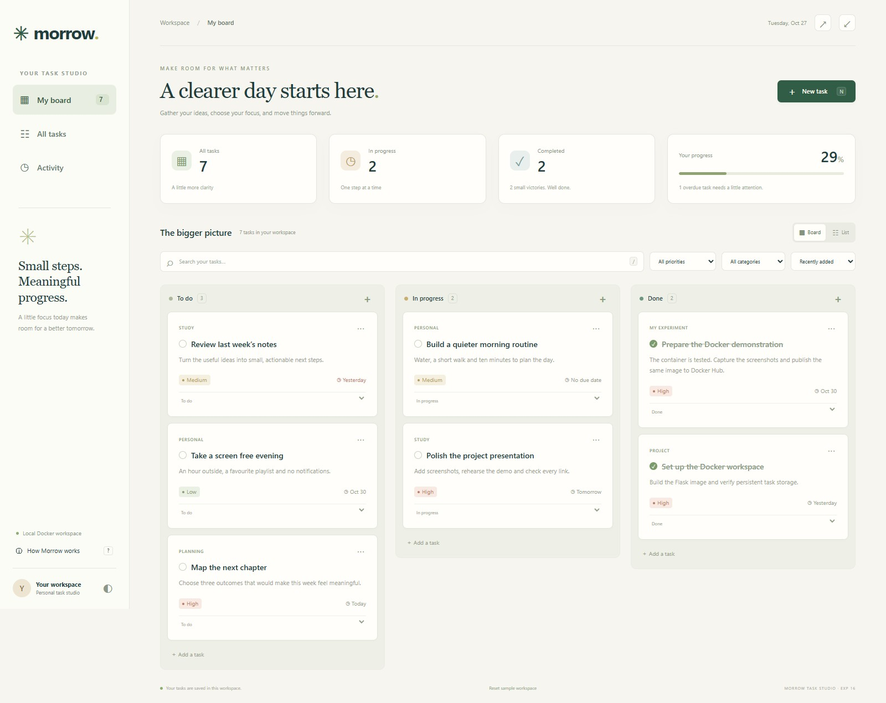
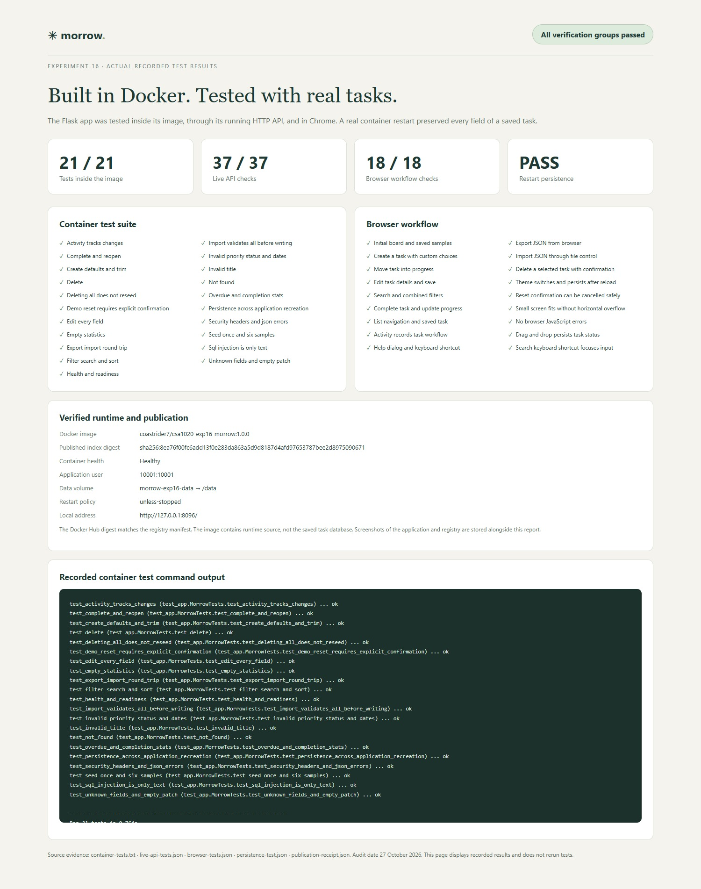

# Experiment 16 — Morrow Task Studio

## Aim

To create a Python Flask to-do application, containerize it with Docker, test its real functionality inside the container, and publish the tested image to Docker Hub. **Morrow Task Studio** combines a calm task board with a persistent SQLite database, so this experiment demonstrates both container execution and durable application data.

**Open in the browser:** [Morrow Task Studio](https://miserable-cobweb-4j9pjv79r7w7fjrqw-8096.app.github.dev/) · [Readiness](https://miserable-cobweb-4j9pjv79r7w7fjrqw-8096.app.github.dev/readyz) · [Docker Hub image](https://hub.docker.com/r/coastrider7/csa1020-exp16-morrow/tags)

The original demonstration used a local loopback port. Its current browser runtime uses a private Codespaces port protected by GitHub sign-in. The application remains a personal sample workspace without its own separate user authentication; the Docker image is published to Docker Hub.

## Tools Required

**Browser Docker lab:** [Open the Codespaces IDE](https://miserable-cobweb-4j9pjv79r7w7fjrqw.github.dev/) · [Manage or restart the lab](https://github.com/codespaces) · [Browser lab guide](https://github.com/Emadfar007/CSA1020---Software-Engineering/tree/main/browser-lab). Sign in as **Emadfar007**, resume the Codespace if stopped, and run `bash browser-lab/bin/lab start 16` from the repository root before opening this experiment's private app links. Starting a profile stops the other lab profiles while preserving their data. The original local commands, screenshots and test evidence below remain the historical experiment record.

| Tool | Use |
|---|---|
| Python 3.13 | Application runtime inside the image |
| Flask 3.1.3 | Web pages and JSON API |
| Gunicorn 26.2.0 | WSGI application server in the container |
| SQLite | Durable task storage in a named Docker volume |
| Docker Desktop and Docker Compose | Build, run, health checks and restart policy |
| Docker Hub account `coastrider7` | Versioned image publication |
| HTML, CSS and JavaScript | Interactive board, forms and accessible status controls |
| Python unittest and Chrome | Automated API tests, browser workflows and screenshots |

### Quick access links

| What to open | Link |
| --- | --- |
| Open or manage the browser lab | [Codespaces IDE](https://miserable-cobweb-4j9pjv79r7w7fjrqw.github.dev/) · [Start or stop Codespaces](https://github.com/codespaces) · [Lab guide](https://github.com/Emadfar007/CSA1020---Software-Engineering/tree/main/browser-lab) |
| Open the running application | [Morrow Task Studio](https://miserable-cobweb-4j9pjv79r7w7fjrqw-8096.app.github.dev/) |
| Check the browser app and saved work | [Readiness](https://miserable-cobweb-4j9pjv79r7w7fjrqw-8096.app.github.dev/readyz) · [Tasks JSON](https://miserable-cobweb-4j9pjv79r7w7fjrqw-8096.app.github.dev/api/tasks) · [Progress statistics](https://miserable-cobweb-4j9pjv79r7w7fjrqw-8096.app.github.dev/api/stats) |
| Download the published image | [Docker Hub image and tags](https://hub.docker.com/r/coastrider7/csa1020-exp16-morrow/tags) |
| Read or download the container configuration | [Dockerfile](https://github.com/Emadfar007/CSA1020---Software-Engineering/blob/main/experiments/experiment-16-flask-todo-docker/Dockerfile) · [Docker Compose](https://github.com/Emadfar007/CSA1020---Software-Engineering/blob/main/experiments/experiment-16-flask-todo-docker/compose.yaml) |
| Browse the application source | [Flask app](https://github.com/Emadfar007/CSA1020---Software-Engineering/blob/main/experiments/experiment-16-flask-todo-docker/app.py) · [Interface files](https://github.com/Emadfar007/CSA1020---Software-Engineering/tree/main/experiments/experiment-16-flask-todo-docker/static) · [Complete experiment](https://github.com/Emadfar007/CSA1020---Software-Engineering/tree/main/experiments/experiment-16-flask-todo-docker) |
| View all ten output screenshots | [Screenshot gallery](https://github.com/Emadfar007/CSA1020---Software-Engineering/tree/main/experiments/experiment-16-flask-todo-docker/screenshots) · [Testing screenshot](https://github.com/Emadfar007/CSA1020---Software-Engineering/blob/main/experiments/experiment-16-flask-todo-docker/screenshots/10-testing-results.jpg) |
| Inspect the test results | [Container tests](https://github.com/Emadfar007/CSA1020---Software-Engineering/blob/main/experiments/experiment-16-flask-todo-docker/evidence/container-tests.txt) · [37 API checks](https://github.com/Emadfar007/CSA1020---Software-Engineering/blob/main/experiments/experiment-16-flask-todo-docker/evidence/live-api-tests.json) · [18 browser checks](https://github.com/Emadfar007/CSA1020---Software-Engineering/blob/main/experiments/experiment-16-flask-todo-docker/evidence/browser-tests.json) |
| Verify restart and publication | [Persistence test](https://github.com/Emadfar007/CSA1020---Software-Engineering/blob/main/experiments/experiment-16-flask-todo-docker/evidence/persistence-test.json) · [Docker Hub receipt](https://github.com/Emadfar007/CSA1020---Software-Engineering/blob/main/experiments/experiment-16-flask-todo-docker/evidence/publication-receipt.json) |
| Start or stop the experiment | [Start script](https://github.com/Emadfar007/CSA1020---Software-Engineering/blob/main/experiments/experiment-16-flask-todo-docker/scripts/start.ps1) · [Stop script](https://github.com/Emadfar007/CSA1020---Software-Engineering/blob/main/experiments/experiment-16-flask-todo-docker/scripts/stop.ps1) · [Live API verifier](https://github.com/Emadfar007/CSA1020---Software-Engineering/blob/main/experiments/experiment-16-flask-todo-docker/scripts/verify-live.py) |
| Return to the experiment collection | [CSA1020 Software Engineering](https://github.com/Emadfar007/CSA1020---Software-Engineering) |

The app and API links above use private Codespaces ports. Run `bash browser-lab/bin/lab start 16` from the repository root first. Saved task data is kept privately at `/workspaces/.lab-data/morrow`; it is not published with the source or image. Docker Hub, source, screenshots and recorded results remain available online when the profile is stopped.


Private app links require both a running profile and GitHub sign-in as Emadfar007. This Codespace uses a 30-minute idle timeout and 30-day inactive retention; free usage remains subject to its monthly quota, with paid usage blocked.

## Algorithm

1. Create [app.py](app.py) with an application factory and SQLite transactions. On the first start, add six varied sample tasks. Record initialization separately so deleting all tasks does not recreate the samples on restart.
2. Build the interface using local assets. Use the board, all-tasks list and activity history to view the same saved data. Implement task creation, editing, completion, deletion, drag-and-drop status changes, priorities, due dates, custom categories, notes, search, filtering and sorting. Add JSON export/import, a theme switch and keyboard shortcuts.
3. Validate requests before writing data. Use parameterized SQLite queries, consistent JSON errors, a request-size limit, date validation and atomic import. Incomplete or invalid requests must return an error without partially changing data.

| Method and endpoint | Behaviour |
|---|---|
| GET `/` | Open the task studio |
| GET `/healthz` and `/readyz` | Process health and database readiness |
| GET `/api/tasks` | List tasks with search, status, priority, category and sorting |
| POST `/api/tasks` | Create a task |
| PATCH `/api/tasks/{id}` | Edit task fields or workflow status |
| DELETE `/api/tasks/{id}` | Delete a selected task |
| GET `/api/stats` | Counts, overdue work and completion percentage |
| GET `/api/activity` | Recent task changes |
| GET `/api/export` | Download a portable JSON backup |
| POST `/api/import` | Validate and add imported tasks atomically |
| POST `/api/demo/reset` | Restore sample data only after explicit confirmation |

4. Create the [Dockerfile](Dockerfile) and [.dockerignore](.dockerignore). Install pinned dependencies, copy only runtime source, run as UID 10001 and serve through Gunicorn on port 8000. Include a database readiness health check with a 15-second budget and a 30-second startup grace period.
5. From this experiment folder, build the image and run the test suite **inside the built image**. The tests use temporary databases, not the saved workspace.

```powershell
docker build --progress=plain -t coastrider7/csa1020-exp16-morrow:1.0.0 .
$morrowTests = Join-Path (Get-Location) 'tests'
docker run --rm --read-only --tmpfs /tmp:rw,size=64m --tmpfs /data:rw,uid=10001,gid=10001 --mount "type=bind,source=$morrowTests,target=/app/tests,readonly" coastrider7/csa1020-exp16-morrow:1.0.0 python -m unittest discover -s tests -v
```

6. Start the application with [compose.yaml](compose.yaml). It binds `127.0.0.1:8096` to container port 8000, mounts the named volume `morrow-exp16-data`, uses `unless-stopped`, limits resources and keeps the root filesystem read-only. The data volume remains writable for SQLite.

```powershell
docker compose up -d --no-build
docker compose ps
```

Open [http://127.0.0.1:8096/](http://127.0.0.1:8096/). Alternatively, run [scripts/start.ps1](scripts/start.ps1); use `./scripts/start.ps1 -Build` to rebuild. [scripts/stop.ps1](scripts/stop.ps1) stops the application while preserving saved tasks.

7. Exercise the API through the running container and the browser. Create a task with personal choices, edit it, move it through To do, In progress and Done, filter it, export/import tasks and inspect activity. Check invalid requests, then create a persistence checkpoint, restart the container and confirm the task is unchanged.
8. Publish the same tested image. Docker credentials remain in the local credential helper and are excluded from this submission.

```powershell
docker push coastrider7/csa1020-exp16-morrow:1.0.0
docker buildx imagetools inspect coastrider7/csa1020-exp16-morrow:1.0.0
```

On another computer with Docker, download the image and start it using the same Compose file:

```powershell
docker compose pull
docker compose up -d --no-build
```

The image contains application code only. Your task database is stored in the volume on the computer running the container and is not uploaded with the image. Keep the volume when stopping the experiment; normal `docker compose stop` preserves it.

## Output Screenshots

The following images are actual captures of the local application, its recorded test results and the published Docker Hub tag.

| Screenshot | Evidence |
|---|---|
| [Task board](screenshots/01-task-board.jpg) | Three workflow columns, saved custom task and progress summary |
| [Custom task editor](screenshots/02-custom-task-editor.jpg) | Personal title, notes, category, due date and priority |
| [Task in progress](screenshots/03-task-in-progress.jpg) | A saved status change in the running container |
| [Search and filters](screenshots/04-filtered-workspace.jpg) | Combined search, category and priority filtering |
| [All tasks](screenshots/05-all-tasks-list.jpg) | Alternate task view with status controls |
| [Activity history](screenshots/06-activity-history.jpg) | Recorded creation, edits and workflow transitions |
| [Dark theme](screenshots/07-dark-theme.jpg) | Working theme switch |
| [Small screen](screenshots/08-small-screen.jpg) | Responsive layout without horizontal overflow |
| [Docker Hub tag](screenshots/09-dockerhub-image.jpg) | Published `1.0.0` image for Linux AMD64 |
| [Container test results](screenshots/10-testing-results.jpg) | Actual recorded unit, HTTP, browser and persistence results |





Detailed evidence: [Build log](evidence/docker-build.txt) · [Container test log](evidence/container-tests.txt) · [37 live API checks](evidence/live-api-tests.json) · [18 browser checks](evidence/browser-tests.json) · [Restart persistence](evidence/persistence-test.json) · [Push log](evidence/docker-push.txt) · [Publication receipt](evidence/publication-receipt.json) · [View the testing report](evidence/testing-results.html).

## Result

Morrow Task Studio was built and run successfully in Docker. **21 of 21 tests inside the image, 37 of 37 live API checks and 18 of 18 browser workflow checks passed.** An additional persistence test restarted the real container and confirmed every saved task field was unchanged. The final container was healthy, running as UID 10001 with a read-only root filesystem and persistent named volume.

The verified image is available at [coastrider7/csa1020-exp16-morrow:1.0.0](https://hub.docker.com/r/coastrider7/csa1020-exp16-morrow/tags). Published index digest:

```text
sha256:8ea76f00fc6add13f0e283da863a5d9d8187d4afd97653787bee2d8975090671
```

The index digest identifies the published image index; Docker Hub also lists its separate Linux AMD64 child manifest digest. Both are recorded in [registry-manifest.txt](evidence/registry-manifest.txt).

The app remains available at [http://127.0.0.1:8096/](http://127.0.0.1:8096/) while Docker is running. Custom tasks can be edited, moved, completed and deleted; task imports add data without replacing existing work. Export creates a portable backup. The six sample tasks and one completed demonstration task are retained for exploration. This experiment does not publish a cloud website or change Experiments 1–15.
