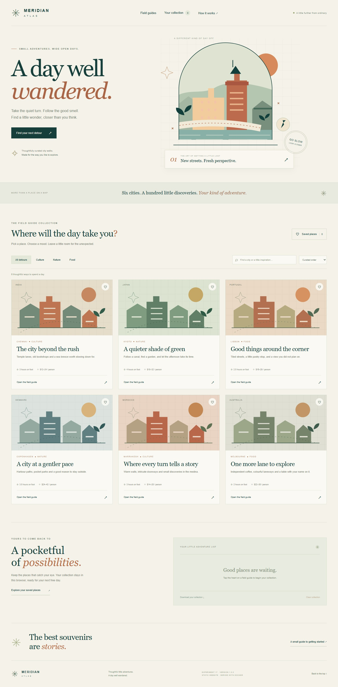
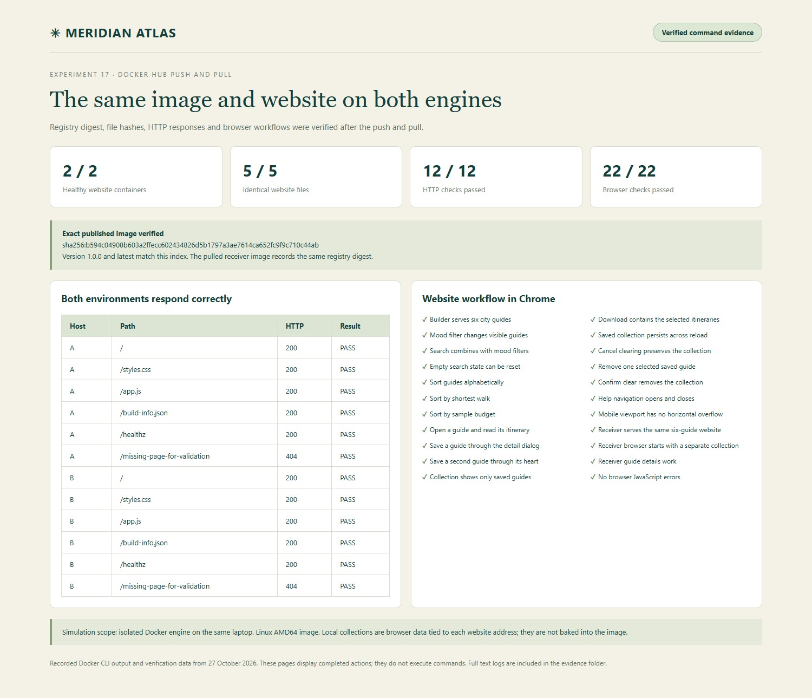

# Experiment 17 — Meridian Atlas Docker Hub Push and Pull

## Aim

To create an original static HTML website, build its Docker image, tag and push it to Docker Hub, then pull and run the published image in an independent Docker environment. **Meridian Atlas** is an illustrated city field guide with working search, mood filters, sorting, itinerary dialogs and a saved collection.

The user approved an **isolated Docker engine on the same laptop** as the sample's second machine. Builder A and Receiver B have different engine IDs and separate image stores. Receiver B started with zero images, downloaded the image from Docker Hub and ran it without rebuilding the source. This is a simulation of another machine, not a claim that a second physical computer was used.

## Tools Required

**Browser Docker lab:** [Open the Codespaces IDE](https://miserable-cobweb-4j9pjv79r7w7fjrqw.github.dev/) · [Manage or restart the lab](https://github.com/codespaces) · [Browser lab guide](https://github.com/Emadfar007/CSA1020---Software-Engineering/tree/main/browser-lab). Sign in as **Emadfar007**, resume the Codespace if stopped, and run `bash browser-lab/bin/lab start 17` from the repository root before opening this experiment's private app links. Starting a profile stops the other lab profiles while preserving their data. The original local commands, screenshots and test evidence below remain the historical experiment record.

| Tool | Purpose |
|---|---|
| Docker Desktop and Docker CLI 29.9.2 | Build, tag, push, pull, inspect and run images |
| Docker Hub account `coastrider7` | Public image repository and versioned tags |
| Official Nginx 1.30.6 Alpine image | Serve the static website as non-root UID 101 |
| Official Docker 29.9.2 DinD image | Separate receiver engine for the approved sample |
| Docker Compose and PowerShell | Local startup and stop commands |
| HTML, CSS, JavaScript and SVG | Website and original illustrations, without external asset dependencies |
| Chrome and HTTP verification | Functional testing and screenshots |

### Quick access links

| What to open | Link |
|---|---|
| Open or manage the browser lab | [Codespaces IDE](https://miserable-cobweb-4j9pjv79r7w7fjrqw.github.dev/) · [Start or stop Codespaces](https://github.com/codespaces) · [Lab guide](https://github.com/Emadfar007/CSA1020---Software-Engineering/tree/main/browser-lab) |
| Open Builder A | [Meridian Atlas on port 8097](https://miserable-cobweb-4j9pjv79r7w7fjrqw-8097.app.github.dev/) · [Health](https://miserable-cobweb-4j9pjv79r7w7fjrqw-8097.app.github.dev/healthz) |
| Open Receiver B | [Pulled image on port 8098](https://miserable-cobweb-4j9pjv79r7w7fjrqw-8098.app.github.dev/) · [Health](https://miserable-cobweb-4j9pjv79r7w7fjrqw-8098.app.github.dev/healthz) |
| View the published image | [Docker Hub tags](https://hub.docker.com/r/coastrider7/csa1020-exp17-meridian-atlas/tags) |
| Read the build and runtime files | [Dockerfile](Dockerfile) · [Nginx configuration](nginx.conf) · [Compose](compose.yaml) |
| Inspect the website source | [HTML](site/index.html) · [Styles](site/styles.css) · [Interactions](site/app.js) · [Version metadata](site/build-info.json) |
| Read every recorded Docker command | [Commands and actual output](evidence/docker-commands-and-output.txt) |
| View the final verification | [Delivery receipt](evidence/delivery-receipt.json) · [Browser checks](evidence/browser-tests.json) · [Summary screenshot](screenshots/12-verification-summary.jpg) |
| Start or stop the builder | [Start Builder A](scripts/start.ps1) · [Stop Builder A](scripts/stop.ps1) |
| Start or stop the receiver sample | [Start Receiver B](scripts/start-receiver.ps1) · [Stop Receiver B](scripts/stop-receiver.ps1) |
| Browse this experiment on GitHub | [Report and source](https://github.com/Emadfar007/CSA1020---Software-Engineering/tree/main/experiments/experiment-17-dockerhub-push-pull) · [All twelve screenshots](https://github.com/Emadfar007/CSA1020---Software-Engineering/tree/main/experiments/experiment-17-dockerhub-push-pull/screenshots) |
| Open the recorded Docker commands online | [Commands and output](https://github.com/Emadfar007/CSA1020---Software-Engineering/blob/main/experiments/experiment-17-dockerhub-push-pull/evidence/docker-commands-and-output.txt) · [Receiver before pull](https://github.com/Emadfar007/CSA1020---Software-Engineering/blob/main/experiments/experiment-17-dockerhub-push-pull/evidence/receiver-before-pull.json) |
| Open verification evidence online | [Delivery receipt](https://github.com/Emadfar007/CSA1020---Software-Engineering/blob/main/experiments/experiment-17-dockerhub-push-pull/evidence/delivery-receipt.json) · [Browser checks](https://github.com/Emadfar007/CSA1020---Software-Engineering/blob/main/experiments/experiment-17-dockerhub-push-pull/evidence/browser-tests.json) · [Summary screenshot](https://github.com/Emadfar007/CSA1020---Software-Engineering/blob/main/experiments/experiment-17-dockerhub-push-pull/screenshots/12-verification-summary.jpg) |
| Return to the collection | [CSA1020 Software Engineering](https://github.com/Emadfar007/CSA1020---Software-Engineering) |

The application links above now use the private Codespaces builder and receiver ports. Run `bash browser-lab/bin/lab start 17` to start both environments on the cloud lab; Docker Desktop is not needed. The original same-laptop demonstration remains documented below. The website makes no bookings, its routes and budgets are illustrative, and saved collections remain browser data tied to each website address.


Private app links require both a running profile and GitHub sign-in as Emadfar007. This Codespace uses a 30-minute idle timeout and 30-day inactive retention; free usage remains subject to its monthly quota, with paid usage blocked.

## Algorithm

1. Create the original website in [site/](site/). Add six city guides, original SVG artwork, combined mood/search filtering, sorting by duration/budget/city, itinerary dialogs, saved collections, text downloads, help and a responsive layout. Store collection choices in localStorage and confirm before clearing them.
2. Write the [Dockerfile](Dockerfile). Pin the official Nginx base by digest, copy only runtime website files, use UID/GID 101 and serve port 8080. Put writable Nginx state under `/tmp`. Restrict the build context using [.dockerignore](.dockerignore).
3. Build the image on Builder A and tag it with both a release version and the `latest` alias. Run these commands from this experiment folder:

```powershell
docker build --progress=plain -t meridian-atlas:1.0.0 .
docker tag meridian-atlas:1.0.0 coastrider7/csa1020-exp17-meridian-atlas:1.0.0
docker tag meridian-atlas:1.0.0 coastrider7/csa1020-exp17-meridian-atlas:latest
docker image ls coastrider7/csa1020-exp17-meridian-atlas
docker compose up -d --no-build
```

Builder A opens at [http://127.0.0.1:8097/](http://127.0.0.1:8097/). Compose provides a read-only filesystem, temporary writable directory, dropped capabilities, resource limits and an `unless-stopped` restart policy. The running website has no source directory bind mount.

4. Use the existing Docker Hub sign-in for `coastrider7`, then upload both tags and inspect the published manifest. On a new computer, run `docker login` yourself before pushing; do not place passwords or tokens in the source or screenshots.

```powershell
docker push coastrider7/csa1020-exp17-meridian-atlas:1.0.0
docker push coastrider7/csa1020-exp17-meridian-atlas:latest
docker buildx imagetools inspect coastrider7/csa1020-exp17-meridian-atlas:1.0.0
```

Both tags were verified against the same published index digest:

```text
sha256:b594c04908b603a2ffecc602434826d5b1797a3ae7614ca652fc9f9c710c44ab
```

Tags are convenient names and can be updated. The digest identifies the exact published image. Docker Hub may also display a separate Linux AMD64 child-manifest digest; this is expected for an image index with provenance metadata.

5. Prepare Receiver B using an official Docker-in-Docker image with a dedicated named data volume. Its daemon listens on its own Unix socket. No host Docker socket is mounted and no Docker TCP API is published. The dedicated receiver uses privileged mode for this local lab; the website containers themselves run without root privileges or extra capabilities. Capture the receiver's zero-image state and distinct engine ID before downloading anything.

The initialization command recorded in the evidence is:

```powershell
docker run -d --name meridian-receiver-exp17-b --hostname meridian-receiver-b --privileged --restart unless-stopped --memory 384m --cpus 1 -e DOCKER_TLS_CERTDIR= -p 127.0.0.1:8098:8080 --mount type=volume,source=meridian-exp17-receiver-data,target=/var/lib/docker docker@sha256:9e79b879b177fbd72c34376a3dd3d91747da5db49e1f560f76aea59561471977 dockerd --host=unix:///var/run/docker.sock --storage-driver=overlay2
docker exec meridian-receiver-exp17-b docker image ls
```

The initial engine list was empty. [receiver-before-pull.json](evidence/receiver-before-pull.json) records both engine IDs and the actual initialization commands. The shared internal path `/var/lib/docker` belongs to different isolated filesystems; it is not a shared image store.

6. Pull the versioned image from Docker Hub into Receiver B. Run the pulled image by digest and map its port through the receiver to local port 8098. These commands were executed in the sample:

```powershell
docker exec meridian-receiver-exp17-b docker pull coastrider7/csa1020-exp17-meridian-atlas:1.0.0
docker exec meridian-receiver-exp17-b docker run -d --name meridian-atlas-exp17-b --restart unless-stopped --read-only --tmpfs /tmp:rw,noexec,nosuid,size=16m --cap-drop ALL --security-opt no-new-privileges:true --memory 64m --cpus 0.5 -p 8080:8080 coastrider7/csa1020-exp17-meridian-atlas@sha256:b594c04908b603a2ffecc602434826d5b1797a3ae7614ca652fc9f9c710c44ab
```

Open [http://127.0.0.1:8098/](http://127.0.0.1:8098/). No `docker build`, `docker save` or source-file copy was used on Receiver B. Its pulled repository digest matches the published index. [scripts/start-receiver.ps1](scripts/start-receiver.ps1) can restart the sample safely and refuses to reuse an existing website container if its image differs from the requested image.

7. To repeat the receiving step on an actual second Linux AMD64 computer with Docker, run the following portable instructions there. These are reproduction instructions; the recorded experiment used the approved isolated-engine simulation above.

```powershell
docker pull coastrider7/csa1020-exp17-meridian-atlas:1.0.0
docker run -d --name meridian-atlas-receiver --restart unless-stopped --read-only --tmpfs /tmp:rw,noexec,nosuid,size=16m --cap-drop ALL --security-opt no-new-privileges:true -p 127.0.0.1:8098:8080 coastrider7/csa1020-exp17-meridian-atlas@sha256:b594c04908b603a2ffecc602434826d5b1797a3ae7614ca652fc9f9c710c44ab
```

8. Verify the published digest against Docker Hub, check both container health states, compare SHA256 hashes of all five website files against the source, and exercise the HTTP routes and browser workflow. Test filtering, search, empty states, sorting, guide details, saved collections, persistence across reload, text download, clearing confirmation, mobile layout and the receiver website. Record the commands, outputs and screenshots.

## Output Screenshots

Website and Docker Hub screenshots are direct browser captures. Command screenshots show clearly labelled evidence pages containing the actual recorded Docker CLI commands and output; they are not simulated terminal sessions. Their complete text records are supplied in [evidence/](evidence/).

| Step | Screenshot |
|---|---|
| Original static website on Builder A | [01 Builder website](screenshots/01-builder-website.jpg) |
| Working city guide and itinerary | [02 Guide details](screenshots/02-destination-detail.jpg) |
| Personal saved collection and download controls | [03 Collection](screenshots/03-personal-collection.jpg) |
| Build the Docker image | [04 Build command and output](screenshots/04-build-command.jpg) |
| Tag the version and latest alias | [05 Tag commands and image list](screenshots/05-tag-command.jpg) |
| Push both image tags | [06 Push commands and digests](screenshots/06-push-command.jpg) |
| Check the repository on Docker Hub | [07 Published Docker Hub tags](screenshots/07-dockerhub-tags.jpg) |
| Show the separate receiver before pulling | [08 Empty receiver and engine IDs](screenshots/08-receiver-before-pull.jpg) |
| Pull the image from Docker Hub | [09 Pull command and output](screenshots/09-pull-command.jpg) |
| Run the pulled image by digest | [10 Receiver run command and health](screenshots/10-receiver-run-command.jpg) |
| Access the website on Receiver B | [11 Receiver website](screenshots/11-receiver-website.jpg) |
| Verify transfer and functional tests | [12 Verification summary](screenshots/12-verification-summary.jpg) |





Detailed records: [All commands and output](evidence/docker-commands-and-output.txt) · [Registry manifest](evidence/08-registry-manifest.txt) · [Docker Hub release tag](evidence/dockerhub-1.0.0.json) · [Delivery receipt](evidence/delivery-receipt.json) · [Browser test results](evidence/browser-tests.json).

## Result

The Meridian Atlas static website was built, tagged as `1.0.0` and `latest`, and pushed successfully to [Docker Hub](https://hub.docker.com/r/coastrider7/csa1020-exp17-meridian-atlas/tags). Receiver B began with zero images, pulled the published version and ran it by digest without rebuilding it.

**Both website containers are healthy. All five website files match across the source, Builder A and Receiver B. All 12 HTTP checks and 22 browser checks passed.** The website runs locally at ports [8097](http://127.0.0.1:8097/) and [8098](http://127.0.0.1:8098/). Twelve screenshots document the build, tags, push, registry, receiver preparation, pull, run and test results.

The second-machine requirement is demonstrated through the user-approved isolated Docker engine on the same laptop. Separate physical hardware and cross-architecture portability were not tested. The published image is Linux AMD64. No public cloud website or paid service was created.

For technical reference, see Docker's official [push documentation](https://docs.docker.com/reference/cli/docker/image/push/), [pull and digest documentation](https://docs.docker.com/reference/cli/docker/image/pull/) and [Docker-in-Docker image documentation](https://hub.docker.com/_/docker).
