# Experiment 18 — SproutHouse Multi-Container Kubernetes Application

## Aim

To build and deploy a complete multi-container application with a frontend, backend and database using Docker and Kubernetes; monitor its workloads through a real Kubernetes dashboard; and demonstrate frontend scaling with measured HTTP requests.

**SproutHouse** is a community seed library with an original botanical interface. Growers can search and filter seed varieties, reserve available stock, view reservation codes, mark packets collected or cancel a reservation. The library can add new varieties and restock existing seeds. A shared activity journal and live service-information page connect those actions to the running application.

## Tools Required

| Tool | Purpose |
|---|---|
| GitHub Codespaces browser lab | Runs the Docker engine and Kubernetes cluster in the cloud; local Docker Desktop is not required. |
| Docker and Dockerfiles | Build separate frontend and backend images. |
| kind and kubectl | Create the named Kubernetes cluster, apply YAML, inspect resources and scale the frontend. |
| NGINX 1.30.6 | Serves the frontend and proxies `/api/` requests to the backend Service. |
| Python 3.12, Flask 3.1.3 and Gunicorn | Run the validated backend API in two replicas. |
| PostgreSQL 16 | Stores the catalog, reservations and activity on a retained PersistentVolumeClaim. |
| Headlamp 0.46.0 | Provides a real Kubernetes dashboard for deployments, pods, Services, events and storage. |
| Python verification scripts | Run backend/API checks and a bounded 120-request load-balancing demonstration. |

### Quick access

| What to open | Link |
|---|---|
| Running application | [SproutHouse seed library](https://miserable-cobweb-4j9pjv79r7w7fjrqw-8180.app.github.dev/) |
| Kubernetes dashboard | [SproutHouse deployments in Headlamp](https://miserable-cobweb-4j9pjv79r7w7fjrqw-8181.app.github.dev/c/SproutHouse-Lab/deployments?namespace=sprouthouse-exp18) |
| Browser terminal | [Codespaces IDE](https://miserable-cobweb-4j9pjv79r7w7fjrqw.github.dev/) |
| Start or stop the cloud machine | [Manage Codespaces](https://github.com/codespaces) |
| Frontend container configuration | [Dockerfile](frontend/Dockerfile) · [NGINX configuration](frontend/nginx.conf) |
| Backend container configuration | [Dockerfile](backend/Dockerfile) · [Flask API](backend/app.py) |
| Kubernetes YAML | [Combined deployment and Services YAML](deployment-and-services.yaml) · [Individual manifests](k8s/) · [kind cluster configuration](cluster/kind-config.yaml) |
| Commands and verification | [Lab operator](scripts/lab.sh) · [API verifier](scripts/verify-api.py) · [Load check](scripts/load-check.py) · [Persistence verifier](scripts/verify-persistence.py) · [Recorded evidence](evidence/) |

Sign in as **Emadfar007**, resume the Codespace if it is stopped, and start this experiment before opening the app links. Keep ports **8180** and **8181** **Private**. These are testing endpoints, available while the lab runs. Codespaces has a monthly free allowance and this lab uses a 30-minute idle timeout and 30-day inactive retention; it is not unlimited permanent hosting. Preserve private backups and stop the Codespace when finished.

Headlamp is used because the original Kubernetes Dashboard is archived and unmaintained; the Kubernetes project recommends Headlamp for new installations. See the [official Kubernetes dashboard guidance](https://kubernetes.io/docs/tasks/access-application-cluster/web-ui-dashboard/) and [Headlamp in-cluster documentation](https://headlamp.dev/docs/latest/installation/in-cluster/).

## Algorithm

1. **Create the three application tiers.** Keep their responsibilities separate:

   | Tier | Workload | Service | Responsibility |
   |---|---|---|---|
   | Frontend | `Deployment/frontend`, initially one replica | `frontend`, NodePort `30180` | Serve the interface, expose the serving pod identity and proxy API calls. |
   | Backend | `Deployment/backend`, two replicas | `backend`, ClusterIP port `8000` | Validate requests and perform catalog, reservation and stock transactions. |
   | Database | `StatefulSet/postgres`, one replica | `postgres` and `postgres-headless`, port `5432` | Persist shared records on `data-postgres-0`, a `512Mi` PVC. |
   | Monitoring interface | `Deployment/headlamp`, one replica | `headlamp`, NodePort `30181` | Inspect actual Kubernetes resources using read-only access. |

   The three application tiers communicate through Kubernetes Service DNS. The database is not exposed through a browser port. Headlamp is the monitoring interface, separate from the application workflow.

2. **Define the deployment and Service YAML.** Use the project namespace `sprouthouse-exp18` and the following manifests:

   | YAML file | Resources |
   |---|---|
   | [00-namespace.yaml](k8s/00-namespace.yaml) | Dedicated namespace. |
   | [01-configmap.yaml](k8s/01-configmap.yaml) | Non-secret application and PostgreSQL connection settings. |
   | [02-database.yaml](k8s/02-database.yaml) | PostgreSQL Services, StatefulSet and retained PVC template. |
   | [03-backend.yaml](k8s/03-backend.yaml) | Backend Service and two-replica Deployment. |
   | [04-frontend.yaml](k8s/04-frontend.yaml) | Frontend Service and one-replica Deployment. |
   | [05-dashboard-rbac.yaml](k8s/05-dashboard-rbac.yaml) | Dashboard ServiceAccount, read-only project workload permissions and navigation metadata permissions. |
   | [06-dashboard.yaml](k8s/06-dashboard.yaml) | Headlamp configuration, Deployment and Service. |

   Startup, readiness and liveness probes check real service health. CPU and memory requests/limits keep the sample bounded. The frontend and backend run as non-root users with read-only root filesystems and temporary writable volumes. PostgreSQL uses its writable data PVC. The database password is generated privately at runtime and injected through a Kubernetes Secret; it is not committed into the YAML.

3. **Build and deploy in the browser terminal.** From this experiment's directory, run:

   ```bash
   bash scripts/lab.sh start --build
   ```

   The actual operator builds the two Docker images, creates or resumes the named kind cluster, loads the images into its independent image store, applies the YAML and waits for the database, backend, frontend and dashboard to become ready. Its main container/deployment commands are:

   ```bash
   docker build -t sprouthouse-frontend:1.0.0 frontend
   docker build -t sprouthouse-backend:1.0.0 backend

   /workspaces/.lab-data/tools/kind create cluster \
     --name sprouthouse-exp18 --config cluster/kind-config.yaml --wait 180s

   /workspaces/.lab-data/tools/kind load docker-image \
     sprouthouse-frontend:1.0.0 sprouthouse-backend:1.0.0 \
     --name sprouthouse-exp18

   export KUBECONFIG=/workspaces/.lab-data/private/sprouthouse-exp18/operator-kubeconfig
   KUBECTL=/workspaces/.lab-data/tools/kubectl

   "$KUBECTL" --context kind-sprouthouse-exp18 apply -f k8s/00-namespace.yaml
   # scripts/lab.sh generates or preserves the private database Secret here.
   "$KUBECTL" --context kind-sprouthouse-exp18 apply \
     -f k8s/01-configmap.yaml -f k8s/02-database.yaml \
     -f k8s/03-backend.yaml -f k8s/04-frontend.yaml \
     -f k8s/05-dashboard-rbac.yaml -f k8s/06-dashboard.yaml
   ```

   Use `scripts/lab.sh` for the complete start sequence. It also exports the kubeconfig, preserves the existing database password and avoids overwriting a manually scaled frontend count on a later resume. The expanded commands above explain the workflow; they are not a replacement for the operator's Secret and readiness steps.

4. **Open and exercise the application.** Search or filter the catalog, reserve a seed using sample contact details, and verify that available stock decreases. Use Reservations to mark a reservation collected or cancel it; cancellation returns its stock once. Add a custom variety, restock it and inspect the activity journal. The system page displays actual frontend/backend pod identities and database information from the running services. The sample does not send email, take payment or perform physical collection.

5. **Monitor pods, Services and storage.** Use the terminal and the namespaced Headlamp link:

   ```bash
   bash scripts/lab.sh status

   export KUBECONFIG=/workspaces/.lab-data/private/sprouthouse-exp18/operator-kubeconfig
   KUBECTL=/workspaces/.lab-data/tools/kubectl
   "$KUBECTL" --context kind-sprouthouse-exp18 -n sprouthouse-exp18 \
     get deployments,statefulsets,pods,services,pvc -o wide
   "$KUBECTL" --context kind-sprouthouse-exp18 -n sprouthouse-exp18 \
     get events --sort-by=.lastTimestamp
   "$KUBECTL" --context kind-sprouthouse-exp18 -n sprouthouse-exp18 \
     logs deployment/backend --tail=40
   ```

   In Headlamp, select context **SproutHouse-Lab** and namespace **sprouthouse-exp18**. Inspect Deployments, Pods, Services and PVCs. Workload and log access is read-only within this namespace; limited node/namespace/storage metadata supports navigation. The dashboard has no Secret-reading or workload-writing permission. Scaling is performed with the operator's kubectl access. The projected ServiceAccount token stays on the server and is refreshed by Kubernetes; do not include tokens or passwords in screenshots.

6. **Measure the baseline with one frontend replica.** Run the API verifier and a bounded load check:

   ```bash
   python3 scripts/verify-api.py
   python3 scripts/load-check.py --requests 120 --workers 8 \
     --expect-pods 1 --output evidence/load-before-scaling.json
   ```

   The recorded baseline contains **24 passing backend tests**, **41/41 passing live API checks**, and **120/120 HTTP 200 responses from one frontend pod**. The API checks cover validation, idempotent reservation creation, stock changes, collection/cancellation, restocking and live database/runtime responses. The verifier retains its clearly identified sample variety and reservation audit trail.

7. **Scale the frontend from one replica to three.** Apply the scaling command and wait for the rollout:

   ```bash
   "$KUBECTL" --context kind-sprouthouse-exp18 -n sprouthouse-exp18 \
     scale deployment/frontend --replicas=3
   "$KUBECTL" --context kind-sprouthouse-exp18 -n sprouthouse-exp18 \
     rollout status deployment/frontend --timeout=180s
   "$KUBECTL" --context kind-sprouthouse-exp18 -n sprouthouse-exp18 \
     get deployment/frontend
   "$KUBECTL" --context kind-sprouthouse-exp18 -n sprouthouse-exp18 \
     get pods -l tier=frontend -o wide

   # Equivalent guarded operator command:
   bash scripts/lab.sh scale 3

   python3 scripts/load-check.py --requests 120 --workers 8 \
     --expect-pods 3 --output evidence/load-after-scaling.json
   ```

   Compare the recorded pod identities before and after scaling. The load script opens independent connections to `/frontend-info`, counts HTTP 200 responses and records each serving frontend pod. It checks actual traffic distribution across the expected pods. This is a small reproducible service/load-balancing demonstration, not a production capacity benchmark or a claim of unlimited load handling.

8. **Check persistent storage and retain the evidence.** Record a known application reservation and the database row counts, recreate the PostgreSQL pod while keeping its StatefulSet and PVC, wait for readiness, then read the same records through the API. Run the supplied check when nobody is editing the library:

   ```bash
   python3 scripts/verify-persistence.py --base http://127.0.0.1:8180 \
     --output evidence/postgres-persistence.json
   ```

   The recorded check restarted only the PostgreSQL StatefulSet. All four tables kept identical row hashes and counts on the same Bound PVC: 14 catalog rows, 5 reservations, 14 activity rows and 5 idempotency keys. The PostgreSQL pod UID and process start time changed, and the frontend API reconnected successfully. Keep the YAML, command output, test JSON and dashboard screenshots together in this project. The lab operator provides `stop` to preserve the named cluster and its data; it does not delete the cluster or PVC.

   ```bash
   bash scripts/lab.sh stop
   ```

### Recorded verification

| Check | Observed result | Evidence |
|---|---|---|
| Backend validation and PostgreSQL transactions | 24 tests passed | [Test log](evidence/backend-tests.log) |
| Live API, stock races and repeated requests | 41 checks passed | [API results](evidence/live-api-tests.json) |
| Before scaling | 120/120 HTTP 200 responses from one frontend pod | [Baseline load](evidence/load-before-scaling.json) |
| After `kubectl scale` | 3/3 frontend replicas; 120/120 HTTP 200 responses across all three pods, with 49, 29 and 42 requests | [Scale commands](evidence/frontend-scaling.txt) · [Load results](evidence/load-after-scaling.json) |
| Final Kubernetes state | Seven Ready/Running pods: three frontend, two backend, one PostgreSQL and one dashboard | [Resource snapshot](evidence/kubernetes-after-scaling.json) · [Terminal status](evidence/kubernetes-status-after-scaling.txt) |
| Database restart | All table hashes/counts identical; same PVC, new PostgreSQL pod/process | [Persistence proof](evidence/postgres-persistence.json) |
| YAML validation | Combined manifest passed server-side dry-run | [Validation log](evidence/yaml-server-validation.txt) |
| Browser workflow | Reserve and collect SH-00021; restock basil from 38 to 43; add Balcony Spinach with 15 packets; search, filter, sort and view history/runtime | [UI observations](evidence/browser-workflow-verification.json) |

### Deployment issues resolved

Headlamp initially rejected the embedded-only `-no-browser` flag, so the regular server configuration now omits it. Its static asset cache used about 32.2 MiB and exceeded an initial 32 MiB temporary-volume cap, causing evictions. The corrected deployment uses a 256 MiB temporary volume with explicit ephemeral-storage requests/limits; the dashboard then remained Ready with zero restarts. The working link opens Deployments filtered to the project namespace, matching its read-only access. Private Codespaces port registration and browser sign-in were verified without making either service public. See [infrastructure observations](evidence/infra-before-scaling-audit.json) and the [final private-port check](evidence/private-browser-ports-final.json).

## Output Screenshots

The following screenshots show the actual browser application and Headlamp Kubernetes dashboard. Passwords, bearer tokens and Secret values are excluded.

1. **Seed catalog** — the live frontend with shared catalog and stock counts.

   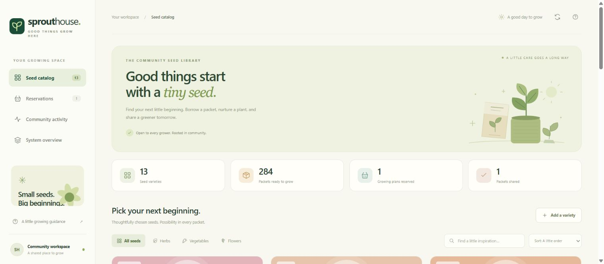

2. **Reservation dialog** — grower details, quantity and real available stock.

   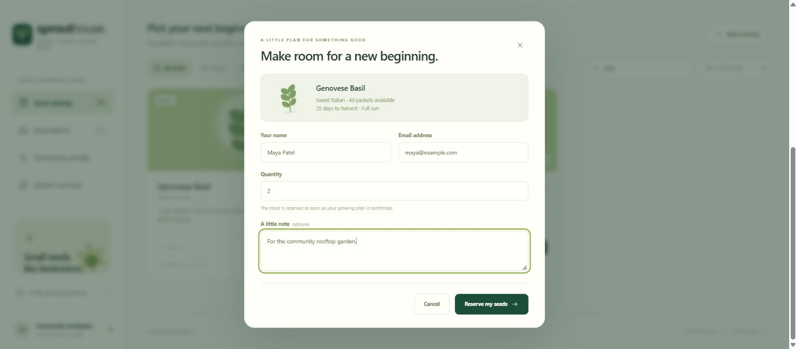

3. **Reservation workflow** — the saved reservation and collection/cancellation actions.

   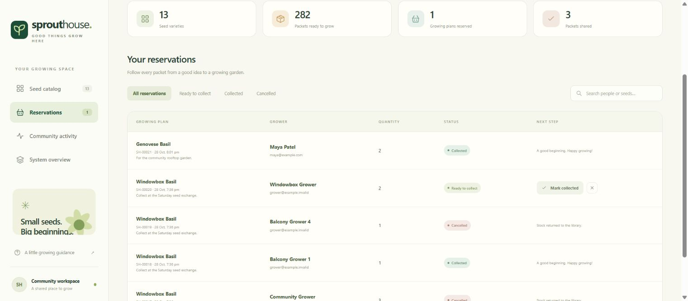

4. **Inventory restocking** — adding packets to the shared seed stock.

   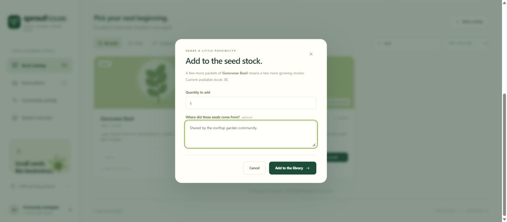

5. **Deployments before scaling** — actual project Deployments in Headlamp.

   

6. **Pods before scaling** — the initial frontend, backend, database and dashboard pods.

   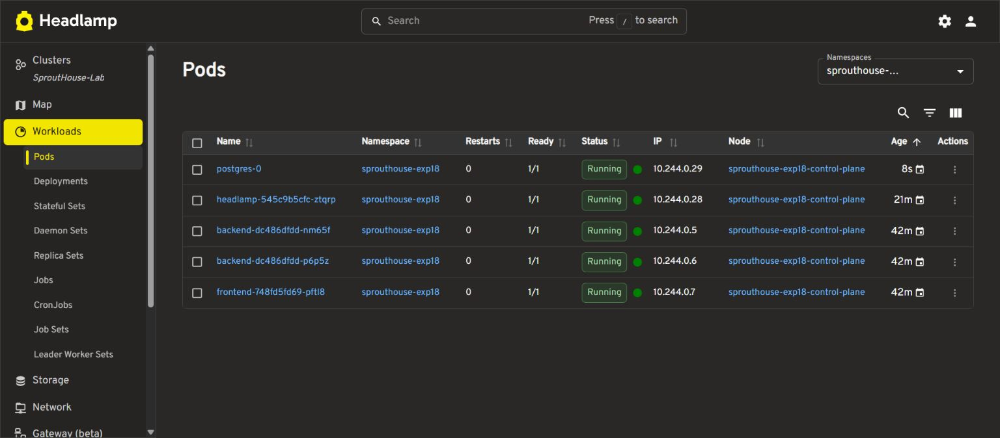

7. **Kubernetes Services** — actual Services and their ports/selectors.

   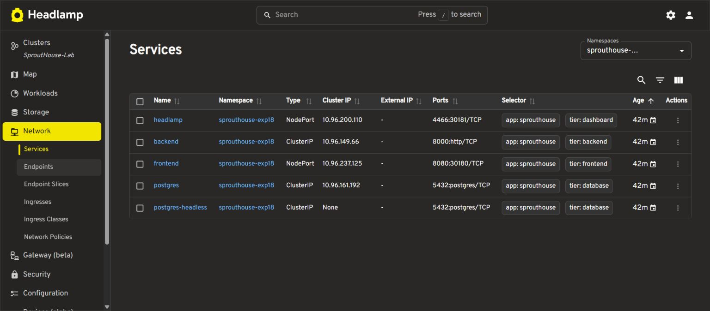

8. **Scaled frontend Deployment** — the frontend Deployment after the scaling workflow.

   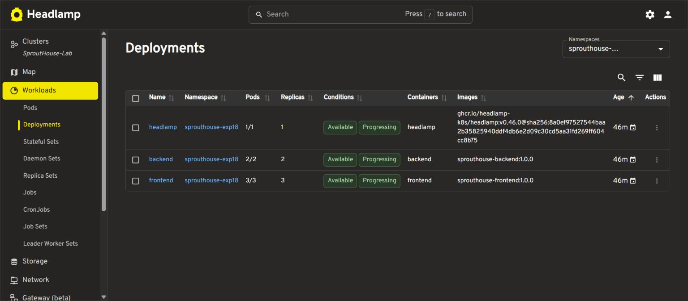

9. **Pods after scaling** — the frontend pod set after scaling.

   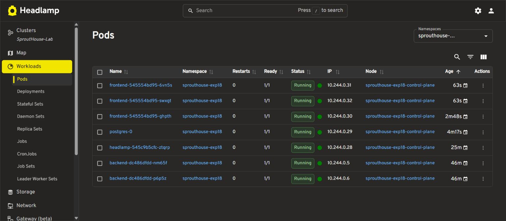

10. **Database persistence** — the same Bound database PVC after the restart; the [matching table hashes and counts](evidence/postgres-persistence.json) verify retained records.

    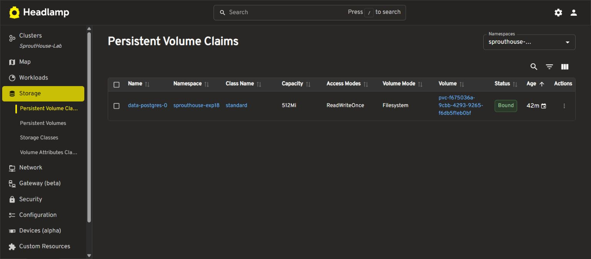

11. **Live runtime overview** — actual service identities and database information.

    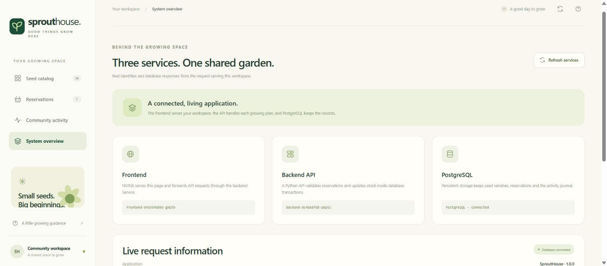

12. **Community activity** — the stored audit trail for application actions.

    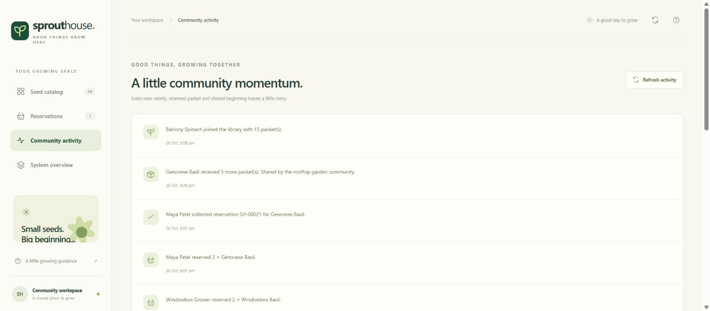

## Result

SproutHouse was built as separate NGINX frontend, Flask backend and PostgreSQL database containers and deployed into a real kind Kubernetes cluster in the browser lab. Verification passed **24 backend tests**, **41 live API checks** and **240 HTTP requests across the before/after scaling checks**. The frontend was scaled from **one to three ready replicas**; traffic reached all three pods. The final cluster had **seven Ready/Running pods**, and the database restart preserved identical data in all four tables on the same persistent volume.

The submitted [combined deployment and Service YAML](deployment-and-services.yaml), [individual manifests](k8s/), [Dockerfiles](frontend/Dockerfile), [operator script](scripts/lab.sh), [recorded evidence](evidence/) and **12 actual screenshots** document deployment, monitoring, scaling and persistence. The application supports catalog search, filters, reservations, pickup/cancellation, variety creation, restocking and activity history. Headlamp provides a real read-only project view, and private Codespaces endpoints keep this an on-demand testing lab. This single-node teaching cluster demonstrates container orchestration; frontend replicas do not make its single database or node highly available.
