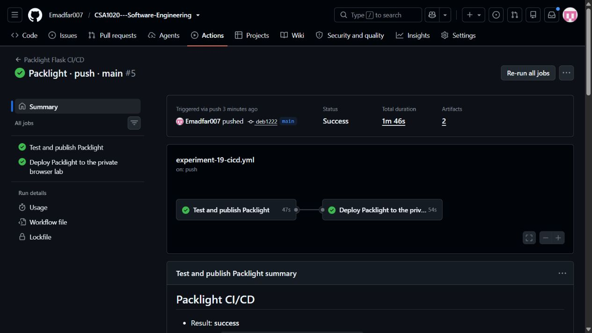
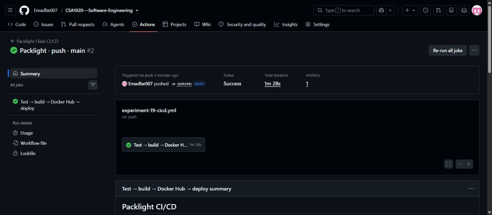

# Experiment 19 — Packlight: Flask CI/CD with GitHub Actions

## Aim

To automate testing, Docker image building, Docker Hub publication and verified deployment of the Flask application to the existing private Codespaces lab using GitHub Actions.

**Packlight** is a small, stateless trip-packing planner. It generates quantities for essentials, clothing, weather and activities from the number of days, travelers and laundry availability.

## Tools Required

**Browser runtime - updated 28 October 2026:** Sign in as **Emadfar007**, resume the [existing Codespace](https://miserable-cobweb-4j9pjv79r7w7fjrqw.github.dev/) and run `bash browser-lab/bin/lab start cicd` from the repository root to start Experiments **13, 14 and 19 together**. The app links require the Codespace and containers to be running. Use `bash browser-lab/bin/lab stop cicd` and stop the Codespace when finished. The existing 2-core lab has a **$0 spending budget with paid usage blocked**, a 30-minute idle timeout and 30-day inactive retention; monthly free compute and storage quotas still apply.

**Verification:** [Automatic browser deployment records](evidence/automatic-browser-deployment-2026-10-28.json) · [Earlier browser runtime checks](evidence/browser-runtime-2026-10-28.json).

**Automatic browser deployment:** The active pipeline now deploys verified new images into the running Codespaces lab. Jenkins handles Experiment 13; hosted Actions and the private outbound deployment agent handle Experiments 14 and 19. Original Render services remain quota-suspended and are retained only as historical deployment evidence.

| Tool | Purpose |
|---|---|
| GitHub repository and GitHub Actions | Source control and automated pipeline |
| GitHub Deployments API, Python and OpenSSL | Request exact-image deployment, protect the temporary callback token and wait for verified completion |
| Python 3.12, Flask 3.1.3 and Gunicorn 26.2.0 | Application, API and production HTTP server |
| Docker and Buildx | Separate test/runtime images and container execution |
| Docker Hub | Store the tested, versioned image and its immutable digest |
| GitHub Codespaces | Receive verified image updates through a private browser port |
| Render Free (original demonstration) | Recorded deployment target; currently quota-suspended |

**Browser application:** [Open Packlight](https://miserable-cobweb-4j9pjv79r7w7fjrqw-8099.app.github.dev/) · [Health](https://miserable-cobweb-4j9pjv79r7w7fjrqw-8099.app.github.dev/healthz) · [Browser build identity](https://miserable-cobweb-4j9pjv79r7w7fjrqw-8099.app.github.dev/api/version)

**Submission:** [Experiment source](https://github.com/Emadfar007/CSA1020---Software-Engineering/tree/main/experiments/experiment-19-github-actions-flask) · [Active workflow YAML](https://github.com/Emadfar007/CSA1020---Software-Engineering/blob/main/.github/workflows/experiment-19-cicd.yml) · [Workflow file copy](workflow/experiment-19-cicd.yml) · [Actions runs](https://github.com/Emadfar007/CSA1020---Software-Engineering/actions/workflows/experiment-19-cicd.yml) · [Docker Hub tags](https://hub.docker.com/r/coastrider7/csa1020-exp19-packlight/tags)

The original [Render Free deployment](https://packlight-exp19.onrender.com/) remains quota-suspended under its [shared service limits](https://render.com/docs/free). The current app link uses the private Codespaces runtime.

## Algorithm

1. Keep the Flask application, its 20 application tests, [Dockerfile](Dockerfile) and [workflow](workflow/experiment-19-cicd.yml) in the repository. The active workflow is `.github/workflows/experiment-19-cicd.yml`.
2. Resume the existing Codespace as **Emadfar007** and run `bash browser-lab/bin/lab start cicd`. Keep this target running during CI/CD. The app, Docker daemon and deployment agent run on the cloud machine; local Docker Desktop is not needed.
3. Keep registry access in the existing `EXP14_DOCKERHUB_USERNAME` and `EXP14_DOCKERHUB_TOKEN` secrets. The browser deployment job uses only its temporary Actions token with `contents: read` and `deployments: write`; it no longer calls a Render hook.
4. Trigger the workflow through an application, test, CI-helper, Dockerfile, deployment-protocol or workflow push to `main`, a related pull request or manual dispatch. Report-only changes do not redeploy the app. **Test and publish Packlight** checks the deployment protocol, builds the Docker test target, runs a nonempty passing test suite and verifies the exact runtime container over HTTP.
5. On trusted `main`, authenticate temporarily to Docker Hub and push that same tested runtime image under a unique run/attempt/SHA tag. Record its immutable digest. Pull requests validate without registry publication or deployment.
6. After the build job succeeds, [request_deployment.py](https://github.com/Emadfar007/CSA1020---Software-Engineering/blob/main/browser-lab/ci/request_deployment.py) creates a GitHub Deployment for the exact source SHA and digest in environment `codespaces-exp19`. The short-lived callback token is encrypted to the lab's public key; its private key stays outside Git.
7. The private lab's outbound [deployment agent](https://github.com/Emadfar007/CSA1020---Software-Engineering/blob/main/browser-lab/ci/deployment_agent.py) verifies the trusted `main` run, repository, workflow path, successful **Test and publish Packlight** job and image identity. It runs a restricted canary, replaces only the named stateless Packlight container and verifies health, source/build identity and the actual API. Failed activation rolls back to the previous working release.
8. The agent updates the GitHub Deployment status. Actions waits up to 600 seconds for a verified success callback; a failed deployment or unavailable lab fails the job instead of reporting success. Preserve the image, test, runtime and deployment receipts as Actions artifacts and [submitted automatic deployment evidence](evidence/automatic-browser-deployment-2026-10-28.json).
9. Open [Packlight](https://miserable-cobweb-4j9pjv79r7w7fjrqw-8099.app.github.dev/) and generate a list for four days, two travelers, rainy weather, trail activity and no laundry. Expect **47 items**, including one shared first aid kit. Verify HTTP 400 for zero days and compare `/api/version` with the deployed source/build identity.

The deployment target must remain active during CI/CD. The existing Codespaces budget is **$0 with paid usage blocked**; monthly free compute, storage and Actions allowances still apply. Use `bash browser-lab/bin/lab stop cicd` and stop the Codespace when finished. The original Render deployment evidence below is retained as a dated demonstration, but Render is no longer the active workflow target.

## Output Screenshots

**Automatic browser deployment, 28 October 2026.** The current pipeline, deployment status or matching running build is recorded with the [automatic deployment receipt](evidence/automatic-browser-deployment-2026-10-28.json).

**Earlier browser runtime restoration, 28 October 2026.** Packlight running from its recorded Docker image in Codespaces.

**Original Render demonstration — 28 October 2026.** The numbered screenshots below preserve that earlier deployment.

**1. Deployed Packlight application.** The working Flask interface and generated packing list.

**2. GitHub Actions pipeline.** The recorded testing, image-publication and deployment run.

## Result

**Current deployment path:** The active pipeline targets the private Codespaces lab and accepts deployment only after image identity, health and application checks. Use the [automatic browser deployment receipt](evidence/automatic-browser-deployment-2026-10-28.json) for the captured run, deployed digest and matching live build. This target requires the running Codespace; a failed or unavailable target is reported as a failed deployment.

**Verified automatic deployment — 28 October 2026:** The push-triggered [Packlight run 5.1](https://github.com/Emadfar007/CSA1020---Software-Engineering/actions/runs/40740904579) completed both the build/publication job and browser deployment job successfully. GitHub Deployment **7393329891** reached success, and the running API matched source `deb12224b0d0c2a7f8142899bb8aa0e805d18238` and build **5.1**. A real stop/start of the CI/CD group retained the new image and restarted the deployment agent.

**Original Render demonstration:** The following results and original screenshots describe the earlier Render run.

The push-triggered [run 2](https://github.com/Emadfar007/CSA1020---Software-Engineering/actions/runs/40714300739) completed successfully for source `dd4d44cdf641f6c3883a5df0dc8f60526ab40d84`. It passed **20 Docker unit tests**, verified the runtime over HTTP, published the tested image to Docker Hub, deployed its immutable digest to Render and verified the matching live source/build identity and API behavior.

Recorded evidence: [20 test results](evidence/unit-tests.txt) · [Container HTTP checks](evidence/container-smoke.json) · [Image and verified cloud deployment](evidence/cloud-deployment.json) · [Actions run and step results](evidence/github-actions-run.json).

The application was verified at [the original Render deployment](https://packlight-exp19.onrender.com/) during the recorded run. Its current browser runtime is [Packlight in Codespaces](https://miserable-cobweb-4j9pjv79r7w7fjrqw-8099.app.github.dev/), available after starting the profile; the Render service remains quota-suspended. The 47-item API fixture passed, and the browser workflow generated 59 items for a six-day rainy trail trip for two travelers, then reduced the list to 47 with laundry enabled. The original receipts preserve that earlier run; the submitted workflow now performs verified automatic deployment to the Codespaces app link.
