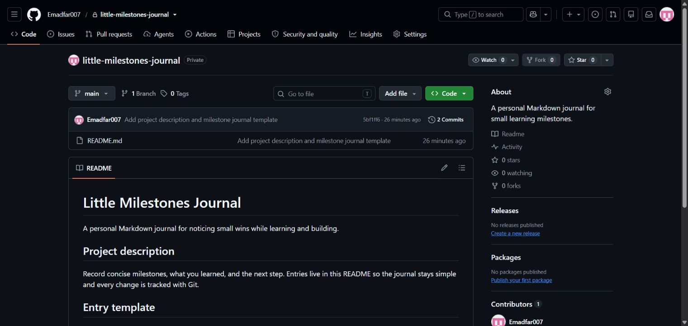
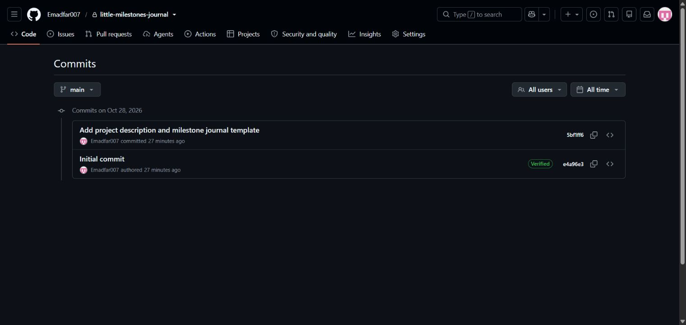

# Experiment 20 — Personal GitHub Repository Setup

## Aim

To create a personal GitHub repository with a README, clone it locally, edit the README, and stage, commit and push the changes using Git.

**Little Milestones Journal** is a simple Markdown journal for recording small learning wins, lessons and next steps.

## Tools Required

| Tool | Purpose |
|---|---|
| Git | Clone, stage, commit, push and verify repository history |
| GitHub and GitHub CLI | Create and host the private repository |
| Local text editing | Update the README with the project description and entry template |

**Links:** [Original private repository](https://github.com/Emadfar007/little-milestones-journal) · [Pushed README commit](https://github.com/Emadfar007/little-milestones-journal/commit/5bf1ff63dd3eddf4baaf37cc31711796affa62be) · [Submitted README snapshot](project/README.md) · [Git workflow evidence](evidence/git-workflow.txt)

The original repository remains private and requires an authorized GitHub sign-in. This experiment contains its README snapshot and workflow evidence.

## Algorithm

1. Create `Emadfar007/little-milestones-journal` as a private repository and initialize `README.md`.
2. Clone the repository to the local machine.
3. Edit the README to add the project description, an entry template and a clearly labeled example milestone.
4. Stage the README, commit the update and push it to `main`.
5. Compare local and remote commit IDs and confirm that the local working tree is clean.

```bash
gh repo create Emadfar007/little-milestones-journal --private --add-readme \
  --description "A personal Markdown journal for small learning milestones."
git clone https://github.com/Emadfar007/little-milestones-journal.git
cd little-milestones-journal
# Edit README.md to add the project description and journal template.
git add README.md
git commit -m "Add project description and milestone journal template"
git push origin main
git status --short
git log --oneline
git rev-parse HEAD
git ls-remote origin refs/heads/main
```

The completed local clone is stored in `work/little-milestones-journal` within the experiment workspace. The commands above record the completed workflow.

## Output Screenshots

**1. README on GitHub** — the private project with its updated description and journal template.



**2. Commit history** — the initialization and subsequent README update.



## Result

On **28 October 2026**, the private repository was created, initialized, cloned locally and updated successfully. Its history contains two commits: initialization `e4a96e3197cb260cac2d2633afd6723044a1bd46` and README update `5bf1ff63dd3eddf4baaf37cc31711796affa62be`.

The update was staged, committed and pushed to `main`. Local and remote HEAD matched `5bf1ff6`, the working tree was clean, and `README.md` was the only tracked project file.
