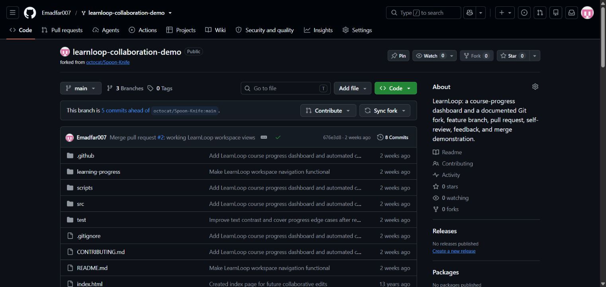
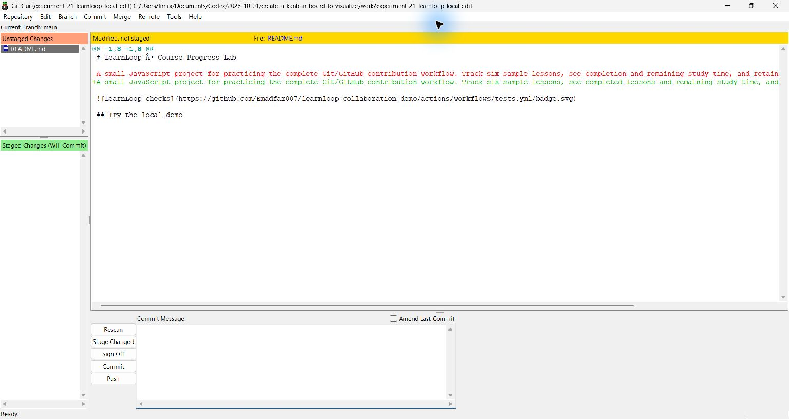

# Experiment 21 — Clone a Public Repository and Save a Small Edit

## Aim

To clone an existing public GitHub repository to the local machine, open a file, make a small text edit and save the change.

## Tools Required

| Tool | Purpose |
|---|---|
| Git | Clone the repository and inspect the saved local difference |
| GitHub | Host the existing public source repository |
| Local text editing | Open and update `README.md` |

**Links:** [Public source repository](https://github.com/Emadfar007/learnloop-collaboration-demo) · [Edited README snapshot](project/README.md) · [Saved change patch](evidence/README-change.patch) · [Git verification](evidence/git-verification.txt)

## Algorithm

1. Select the existing public **LearnLoop — Course Progress Lab** repository.
2. Run `git clone` to create a fresh local copy, then navigate into that directory.
3. Open `README.md` and clarify the project description on line 3.
4. Save the file and use `git diff` and `git status` to verify that only the intended line changed.

```bash
git clone https://github.com/Emadfar007/learnloop-collaboration-demo.git experiment-21-learnloop-local-edit
cd experiment-21-learnloop-local-edit
# Open README.md, edit the description and save the file.
git diff -- README.md
git diff --check
git status --short
```

The local clone is `work/experiment-21-learnloop-local-edit` within the experiment workspace. Its starting commit is `676e3d888b73d529d49d6ee7ffa3b21952e8c0dc`.

| Description text | Wording |
|---|---|
| Before | “see completion and remaining study time, and retain your progress in the current browser.” |
| After | “see completed lessons and remaining study time, and keep your progress saved in the same browser.” |

The original task ends with saving the edit. The change stays unstaged and uncommitted in the LearnLoop clone. This experiment report, README snapshot and evidence are published separately in the Software Engineering repository.

## Output Screenshots

**1. Existing public source repository.** The repository selected for cloning.



**2. Saved local edit.** The modified README and its local change evidence.



## Result

The public repository was cloned successfully, and one description line in `README.md` was edited and saved. Git reported only `README.md` as modified, with one line added and one line removed. The whitespace check passed, and the clone's HEAD remained at the starting commit.

The completed work satisfies repository selection, cloning, file opening, a small text modification and saving. The original source repository is unchanged; the experiment submission contains the saved README snapshot and verification evidence.
