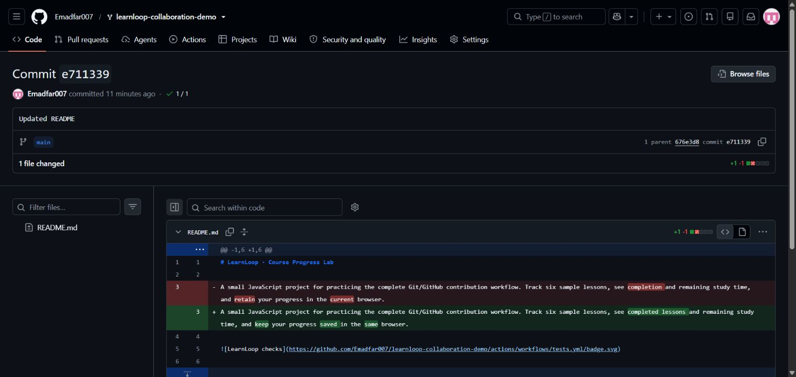

# Experiment 22 — Stage, Commit and Push a README Update

## Aim

To stage a saved file modification, commit it locally with the exact message **Updated README**, and push the commit to GitHub.

## Tools Required

| Tool | Purpose |
|---|---|
| Git | Stage, commit, push and verify the file change |
| GitHub | Host the source repository and published commit |
| Local text editing | Save the README description clarification |

**Links:** [LearnLoop repository](https://github.com/Emadfar007/learnloop-collaboration-demo) · [Published commit](https://github.com/Emadfar007/learnloop-collaboration-demo/commit/e711339b1c18a6258cbf7de1973ab0e9bbe23217) · [README snapshot](project/README.md) · [Change patch](evidence/README-change.patch) · [Historical Git evidence](evidence/git-history.txt)

## Algorithm

1. Use the LearnLoop repository cloned in Experiment 21, stored at `work/experiment-21-learnloop-local-edit`.
2. Keep the saved one-line README clarification describing completed lessons, remaining study time and progress saved in the same browser.
3. Stage only `README.md` with `git add`.
4. Commit the change using the exact message `Updated README`.
5. Push `main` to GitHub and compare the local and remote commit IDs.

```bash
cd experiment-21-learnloop-local-edit
git add README.md
git commit -m "Updated README"
git push origin main
git rev-parse HEAD
git ls-remote origin refs/heads/main
git status --short
```

These commands record the completed workflow. The submitted README and patch are extracted from the historical commit, preserving this experiment's file version as later experiments continue.

## Output Screenshots

**1. Published README commit.** The exact commit message and one-file README change on GitHub.



## Result

On **28 October 2026**, the saved README change was staged, committed locally and pushed successfully. The commit message is **Updated README**, and its SHA is `e711339b1c18a6258cbf7de1973ab0e9bbe23217`.

Only `README.md` changed, with one line added and one removed. At completion, local and GitHub `main` matched this commit and the working tree was clean. The source repository's later history retains the published commit.
