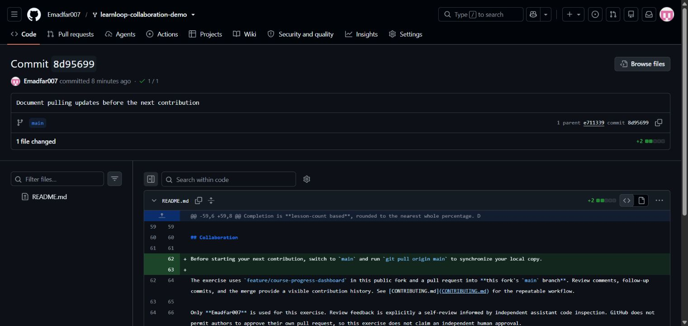

# Experiment 23 — Pull Updates from GitHub

## Aim

To receive a change pushed from a collaborator workspace by running `git pull origin main` in an earlier local clone and verifying the updated file.

This user-approved simulation used two local clones and the same **Emadfar007** account. The second clone represented the collaborator workspace.

## Tools Required

| Tool | Purpose |
|---|---|
| Git | Clone, commit, push, pull and inspect repository history |
| GitHub | Host the shared LearnLoop repository |
| Two local clones | Represent the reader and simulated collaborator workspaces |

**Links:** [Source repository](https://github.com/Emadfar007/learnloop-collaboration-demo) · [Collaborator update commit](https://github.com/Emadfar007/learnloop-collaboration-demo/commit/8d9569910648791e4a0531233889c0ab402e1217) · [Pulled README snapshot](project/README.md) · [Update patch](evidence/collaborator-update.patch) · [Pull verification](evidence/pull-verification.txt)

## Algorithm

1. Use the earlier LearnLoop clone as the reader workspace, initially at `e711339`.
2. Create a second clone to represent the collaborator. Add a short README paragraph explaining how to synchronize the shared project.
3. Stage, commit and push that update from the simulated collaborator clone.
4. Run `git pull origin main` in the earlier reader clone.
5. Verify that the new paragraph appears, the reader reaches commit `8d95699`, and its working tree is clean.

```bash
# Simulated collaborator workspace
git clone https://github.com/Emadfar007/learnloop-collaboration-demo.git experiment-23-collaborator-clone
cd experiment-23-collaborator-clone
# Edit README.md and save the collaboration guidance.
git add README.md
git commit -m "Document pulling updates before the next contribution"
git push origin main

# Earlier reader workspace
cd ../experiment-21-learnloop-local-edit
git pull origin main
git log -1 --oneline
git status --short
```

The added paragraph reads: “Before starting your next contribution, switch to `main` and run `git pull origin main` to synchronize your local copy.”

## Output Screenshots

**1. Published simulated collaborator update.** The README change available for the reader to pull.



## Result

The simulated collaborator pushed commit `8d9569910648791e4a0531233889c0ab402e1217`. The earlier reader clone then ran `git pull origin main` and fast-forwarded from `e711339` to `8d95699`, receiving two inserted lines in `README.md`.

Verification at the end of this experiment confirmed that the added paragraph was present, the reader and GitHub commit IDs matched, and the reader working tree was clean. The snapshot and evidence preserve that completed state; later experiments subsequently advanced the repository.
