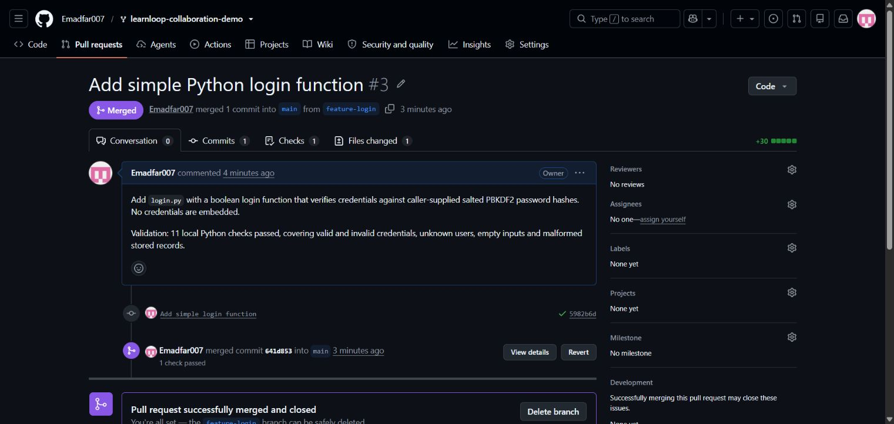

# Experiment 24 — Feature Branch, Login Function and Pull Request

## Aim

To create a `feature-login` branch, implement a simple Python login function, commit and push the file, then open and merge a pull request into `main`.

## Tools Required

| Tool | Purpose |
|---|---|
| Git and GitHub | Create the branch, commit, push and merge a pull request |
| Python standard library | Check credentials against salted PBKDF2 password hashes |
| GitHub Actions | Run the repository's existing JavaScript checks before merging |

**Links:** [Source repository](https://github.com/Emadfar007/learnloop-collaboration-demo) · [Merged pull request #3](https://github.com/Emadfar007/learnloop-collaboration-demo/pull/3) · [Merged login.py](https://github.com/Emadfar007/learnloop-collaboration-demo/blob/main/login.py) · [Submitted login.py snapshot](project/login.py) · [PR metadata](evidence/pull-request.json) · [Git history evidence](evidence/branch-and-merge.txt)

## Algorithm

1. Use the existing LearnLoop clone, confirm its working tree is clean and synchronize `main`. The starting commit was `8d9569910648791e4a0531233889c0ab402e1217`.
2. Create and switch to the requested `feature-login` branch.
3. Add `login.py` with a `login(username, password, users)` function. It returns a Boolean after checking caller-supplied salted password hashes, and rejects invalid credentials or malformed records.
4. Stage `login.py`, commit it and push `feature-login` to GitHub.
5. Open pull request **#3** from `feature-login` into `main`. Review the one-file change and wait for the existing checks to pass.
6. Merge the pull request, return to the local `main` branch and pull the merged result.
7. Verify that `login.py` is present on `main`, its contents match the feature-branch version and the working tree is clean.

```bash
git switch -c feature-login
# Create login.py and complete the local Python checks.
git add login.py
git commit -m "Add simple login function"
git push --set-upstream origin feature-login
# Open and merge pull request #3 on GitHub.
git switch main
git pull origin main
git status --short
```

The feature commit is [`5982b6d`](https://github.com/Emadfar007/learnloop-collaboration-demo/commit/5982b6da3e5631b19c52bcb6a6f7aeb88fa7571e). The function is standalone; callers provide the user records and unique salts. No credentials are embedded in the source.

Validation used **11 local Python checks** covering valid credentials, wrong passwords, unknown users, empty or non-string inputs, missing user mappings and malformed records, salts or hashes. The existing [Course progress tests](https://github.com/Emadfar007/learnloop-collaboration-demo/actions/runs/40728861662) also passed; that workflow checks JavaScript and does not run the Python login checks.

## Output Screenshots

**1. Merged login pull request.** GitHub shows `feature-login` merged into `main` through pull request #3.



## Result

The `feature-login` branch was created, `login.py` was committed and pushed, and pull request **#3** was merged successfully. The PR was created and merged using **Emadfar007**; independent human approval is not claimed.

The merge commit is [`641d853`](https://github.com/Emadfar007/learnloop-collaboration-demo/commit/641d853e3bf6a9ade5978157c982717319b11243). Local `main` matched that GitHub commit, the merged function matched the reviewed feature file, and the local working tree was clean. The supplied source snapshot and evidence preserve the completed experiment.
