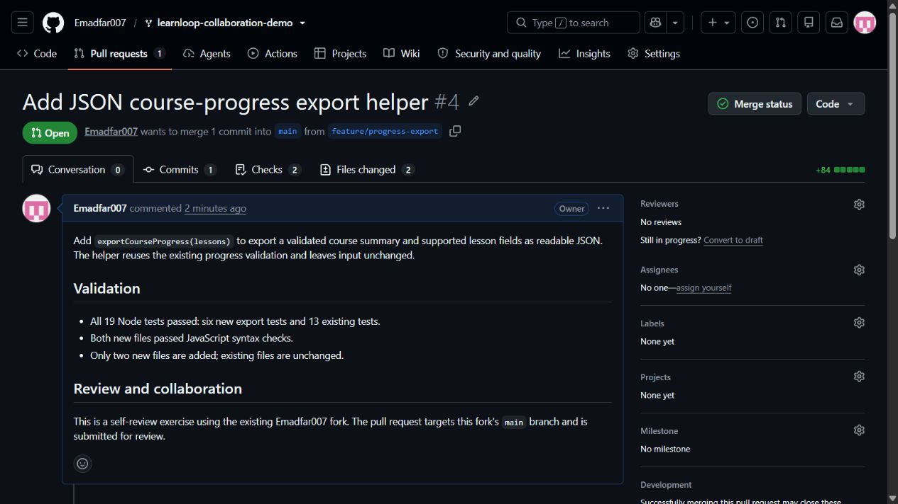
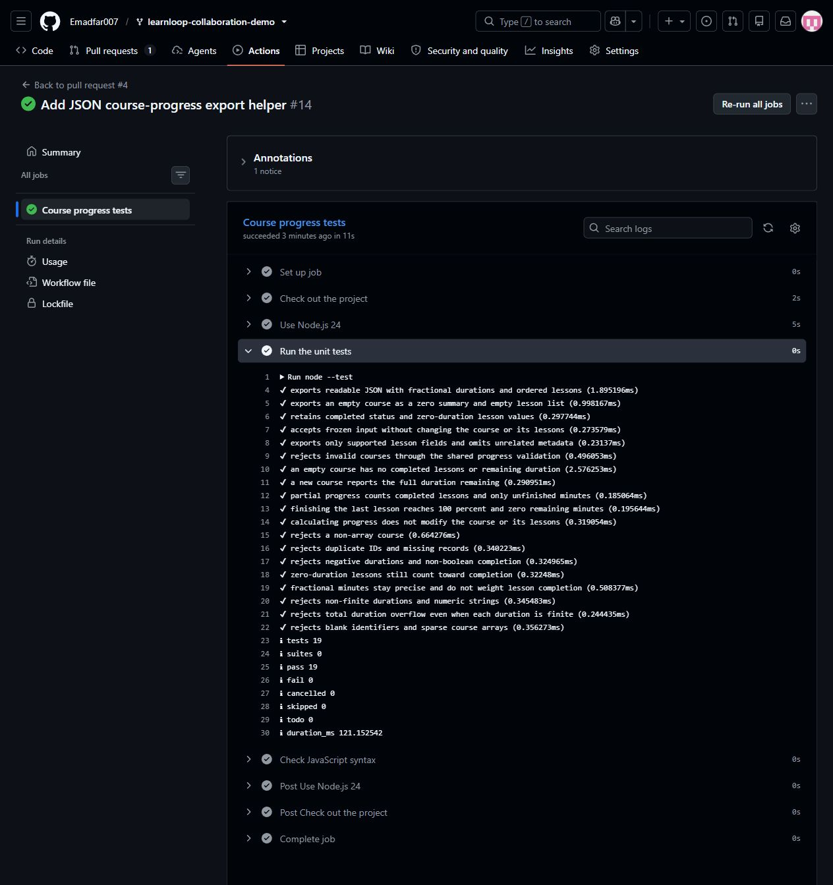

# Experiment 25 — Fork, Feature Branch and Pull Request

## Aim

To use a forked GitHub repository, fetch the latest changes, implement an isolated feature on a new branch, push the branch and submit a pull request.

## Tools Required

| Tool | Purpose |
|---|---|
| Git | Clone, fetch, create a feature branch, commit and push |
| GitHub | Host the fork, feature branch and pull request |
| Node.js 22 or later | Run the JavaScript helper and its tests |
| GitHub Actions | Verify the branch and pull request with automated checks |

**Links:** [Emadfar007 source repository](https://github.com/Emadfar007/learnloop-collaboration-demo) · [Feature branch](https://github.com/Emadfar007/learnloop-collaboration-demo/tree/feature/progress-export) · [Open pull request #4](https://github.com/Emadfar007/learnloop-collaboration-demo/pull/4) · [Feature commit](https://github.com/Emadfar007/learnloop-collaboration-demo/commit/55bebd55ff7e05c062bab229da60997f796e9e40) · [Push checks](https://github.com/Emadfar007/learnloop-collaboration-demo/actions/runs/40732093256) · [Pull-request checks](https://github.com/Emadfar007/learnloop-collaboration-demo/actions/runs/40732125678) · [Submitted helper source](project/src/export-progress.js) · [PR metadata](evidence/pull-request.json) · [Branch evidence](evidence/branch-and-tests.txt) · [Snapshot test output](evidence/snapshot-tests.txt)

## Algorithm

1. Reuse **Emadfar007/learnloop-collaboration-demo**, an existing fork of `octocat/Spoon-Knife`, and clone it into a separate local workspace.
2. Fetch `origin` and the upstream `main` reference. Confirm that the local `main` begins at `641d853e3bf6a9ade5978157c982717319b11243`.
3. Create and switch to `feature/progress-export`.
4. Add `src/export-progress.js`. Its `exportCourseProgress(lessons)` function reuses the existing validation and exports the course summary and supported lesson fields as readable JSON without changing the input.
5. Add `test/export-progress.test.js`, covering formatted export, fractional durations, empty courses, completed courses, immutable input, supported fields and invalid data. Run all 19 Node tests and check the two new files' syntax.
6. Stage only the two new files, commit the feature and push the branch to the Emadfar007 fork.
7. Open pull request **#4** from `feature/progress-export` into the same fork's `main`. Review the two-file diff and verify both GitHub Actions runs pass. Leave the PR open for review, as requested.

```bash
git clone https://github.com/Emadfar007/learnloop-collaboration-demo.git experiment-25-fork-feature
cd experiment-25-fork-feature
git fetch origin
git remote add upstream https://github.com/octocat/Spoon-Knife.git
git fetch upstream main
git switch -c feature/progress-export
# Add the export helper and its test file.
npm test
node --check src/export-progress.js
node --check test/export-progress.test.js
git add src/export-progress.js test/export-progress.test.js
git commit -m "Add JSON course progress export helper"
git push --set-upstream origin feature/progress-export
# Open PR #4 into Emadfar007/learnloop-collaboration-demo:main.
```

The [submitted project snapshot](project/) contains the helper, its existing progress dependency, both test files and the original package metadata from feature commit `55bebd5`. Run `npm test` from `project/` to reproduce the 19 helper/progress checks. The snapshot does not include the dashboard or its server.

## Output Screenshots

**1. Open feature pull request.** GitHub shows PR #4 targeting `main` within Emadfar007's repository.



**2. Passing automated checks.** The expanded GitHub Actions job shows all 19 tests passing, zero failures and the syntax-check step.



## Result

The existing fork was cloned, its remote references fetched, and `feature/progress-export` was created and pushed at commit [`55bebd5`](https://github.com/Emadfar007/learnloop-collaboration-demo/commit/55bebd55ff7e05c062bab229da60997f796e9e40). Exactly two new files were added; existing source files were unchanged. All **19 tests** passed, and both GitHub Actions runs succeeded.

[Pull request #4](https://github.com/Emadfar007/learnloop-collaboration-demo/pull/4) is **open and unmerged**. Both its source and target are under **Emadfar007**, following the user's instruction to keep the work in that account. No independent human reviewer or approval is claimed. The screenshots, source snapshot and evidence preserve this completed submission state.
